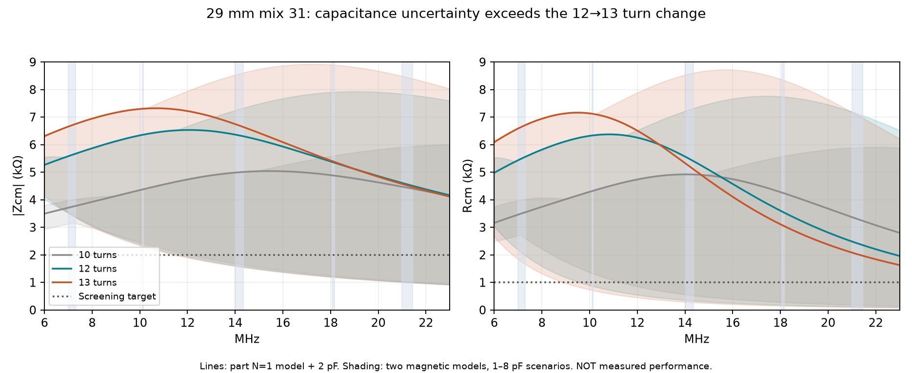

# Bifilar 1:1 choke screening — 17 September 2026

Uncalibrated small-signal scenarios. No measured balun rating.

## Selected 29 mm mix 31 core

Band minima across each band, both magnetic models and 1–8 pF scenarios:

| Turns | Band | Range of minimum magnitude (Ω) | Range of minimum R (Ω) |
| ---: | --- | ---: | ---: |
| 12 | 40m | 3380–5581 | 1974–5434 |
| 12 | 30m | 2345–6354 | 860–6332 |
| 12 | 20m | 1569–7246 | 335–7218 |
| 12 | 17m | 1197–7905 | 177–7737 |
| 12 | 15m | 994–7796 | 115–7057 |
| 13 | 40m | 3357–6656 | 1660–6586 |
| 13 | 30m | 2301–7301 | 706–7116 |
| 13 | 20m | 1544–8533 | 276–8530 |
| 13 | 17m | 1183–8892 | 148–8331 |
| 13 | 15m | 984–8394 | 96–6969 |

## Equal-winding comparison

Material model, 12 turns, assumed 2 pF. This common C assumption
isolates core geometry/material; actual builds will have different C.

| Core | Ferrite g | 40 m min magnitude / R (Ω) | 20 m min magnitude / R (Ω) |
| --- | ---: | ---: | ---: |
| 2631801802 | 7 | 2410 / 2151 | 3470 / 3458 |
| 2631801802x2 | 14 | 5218 / 5040 | 6090 / 5276 |
| 2631801202 | 24 | 5011 / 4818 | 5986 / 5286 |
| 2631801202x2 | 48 | 10268 / 10030 | 6716 / 3327 |
| 5943001001 | 13 | 2597 / 2103 | 3742 / 3719 |
| 5943002701 | 33 | 4973 / 4421 | 6088 / 5604 |
| 2631803802 | 118 | 5974 / 5850 | 6379 / 5128 |

See [method and interpretation](../../docs/case-studies/bifilar-choke.md)
for selection, assumptions, provenance and bench acceptance.

