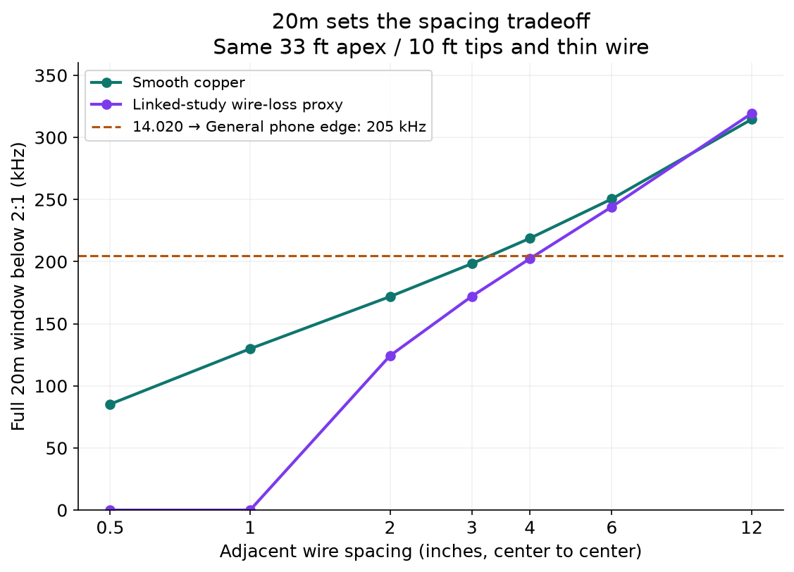
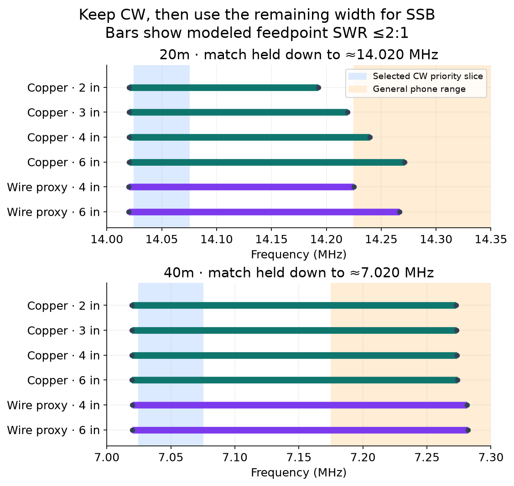

# Fan dipole bandwidth: CW first, some General SSB

**33 ft apex / 10 ft outer tips · same constant-spacing fan and thin-wire assumptions as the first study.**

**Four-inch adjacent spacing is the compact compromise with the smooth-copper model. Six inches buys a more useful slice of General SSB on 20m.** Two inches works well for a CW-focused antenna, but cannot retain the lower CW frequencies and also reach General phone on 20m at ≤2:1. With the linked study’s uncalibrated copper-clad-steel loss proxy, use the six-inch result as the first tested candidate with useful room in both.

Your clarified priority is CW first with some General SSB. For this experiment, the **lower match edge is held near 7.020 and 14.020 MHz**. The illustrative CW priority slices are 7.025–7.075 and 14.025–14.075 MHz; these are planning choices, not definitions of the legal CW allocations. The match extends continuously through the intervening frequencies. 30m is centered on its 10.100–10.150 MHz band.

“General SSB” is interpreted as the U.S. General phone ranges, **7.175–7.300 and 14.225–14.350 MHz**, following the [ARRL U.S. allocation chart](https://www.arrl.org/frequency-bands). Frequency windows below describe antenna matching; usable SSB carrier settings must also leave room for the occupied emission at a subband edge.



## The resulting operating windows

All antennas in this table are separately tuned for CW-first coverage. These are true modeled 2:1 crossing pairs, rounded to 1 kHz; a crossing is a boundary, not operating margin. The widths alone do not guarantee identical deployment performance.

| Wire / adjacent spacing | 40m ≤2:1 MHz | 30m | 20m ≤2:1 MHz | General SSB intersection on 20m |
| --- | --- | --- | --- | --- |
| Copper · 2 in | 7.020–7.273 | full band | 14.020–14.193 | none |
| Copper · 3 in | 7.020–7.273 | full band | 14.020–14.219 | none |
| Copper · 4 in | 7.020–7.274 | full band | 14.020–14.240 | 14.225–14.240 |
| Copper · 6 in | 7.020–7.274 | full band | 14.020–14.271 | 14.225–14.271 |
| Wire proxy · 4 in | 7.020–7.281 | full band | 14.020–14.225 | edge only (<0.1 kHz) |
| Wire proxy · 6 in | 7.020–7.282 | full band | 14.020–14.267 | 14.225–14.267 |



**My build preference: 4 inches if packing width is the deciding constraint; 6 inches if the extra 20m SSB room matters.** Four inches between adjacent wires means **8 inches between the outer wire centers**; six inches means **12 inches overall**. That points toward folding/removable spreaders for a normal winder. Permanent half-inch spacers cannot provide these wider-ribbon results. The model does not establish spacer intervals, sag resistance, packed dimensions or a mechanical design.

A four-inch copper build only reaches a small part of General phone on 20m, so preserve margin when choosing a working frequency. Six inches is more forgiving in frequency coverage. A change in spacing, tip height, feed hardware or wire loss can move these windows; the [first study’s redeployment tests](../fan-dipole-v1/README.md#can-the-tuning-remain-a-one-time-job) show why repeatable geometry matters.

The four-inch wire-proxy result ends at 14.225057 MHz, only about 57 Hz into General phone. That is effectively an edge touch, not useful SSB bandwidth, and is smaller than the numerical/window-position tolerances. Six inches extends the proxy result to about 14.267 MHz.

## Starting points for a prototype

These are modeled **per-side branch lengths beyond the ideal source bridge**, not guaranteed cut lengths. Start long to allow for actual jacket, end attachment and feed hardware. The resonance targets below place the match windows for CW first; use the original 40→30→40→20→30→40 tuning sequence with the entire fan assembled.

| Wire / spacing | 40m half / target | 30m half / target | 20m half / target |
| --- | --- | --- | --- |
| smooth-copper / 4 in | 32.724 ft / 7.147 MHz | 23.142 ft / 10.125 MHz | 16.581 ft / 14.128 MHz |
| smooth-copper / 6 in | 32.727 ft / 7.147 MHz | 23.174 ft / 10.125 MHz | 16.592 ft / 14.141 MHz |
| CCS-proxy / 6 in | 32.597 ft / 7.155 MHz | 23.091 ft / 10.132 MHz | 16.543 ft / 14.151 MHz |

## Where the diminishing returns begin

This width comparison retains the original 7.100/10.120/14.135 MHz resonance targets. Widths use both full crossings before clipping to a band. The separately retuned CW-first windows above are the relevant operating recommendations.

| Adjacent spacing in | Outer-center width in | Copper 20m width kHz | Wire-proxy 20m width kHz |
| --- | --- | --- | --- |
| 0.5 | 1 | 85 | 0 |
| 1 | 2 | 130 | 0 |
| 2 | 4 | 172 | 124 |
| 3 | 6 | 198 | 172 |
| 4 | 8 | 219 | 202 |
| 6 | 12 | 250 | 244 |
| 12 | 24 | 315 | 319 |

Copper improves from about 85 kHz at ½ inch to 172 kHz at 2 inches, then 219 kHz at 4 inches and 250 kHz at 6 inches. Thus 4→6 inches adds about 31 kHz while increasing overall ribbon width from 8 to 12 inches. A 12-inch adjacent-spacing reference is much wider physically; it is a trend comparator, not a backpack-winder recommendation.

**Repositioning the window does not create bandwidth.** For 40m the approximately 250–260 kHz window already covers most of the 300 kHz band when positioned properly. For 30m there is ample width. On 20m, a half-inch copper window cannot bridge the roughly 205 kHz from our lower match edge to the start of General phone. This is why optimizing just the lowest SWR at 14.135 MHz was insufficient.

## Comparison with centering on whole bands

For reference, a separate run centers each actual match window inside 7.000–7.300, 10.100–10.150 and 14.000–14.350 MHz. This can sacrifice your lowest CW frequencies, so it is not the recommended tuning for your stated priority.

| Wire / spacing | 40m coverage | 30m coverage | 20m coverage | 20m window MHz |
| --- | --- | --- | --- | --- |
| smooth-copper / 2 in | 84% | 100% | 50% | 14.088–14.262 |
| smooth-copper / 4 in | 85% | 100% | 63% | 14.065–14.285 |
| smooth-copper / 6 in | 85% | 100% | 72% | 14.049–14.301 |
| CCS-proxy / 4 in | 87% | 100% | 59% | 14.072–14.278 |

## Reproduce, limitations and saved data

The existing common-feed NEC formulation is reused. Every spacing/material is retuned with the full assembly present. Actual SWR crossings are found numerically, then resonance targets are iteratively shifted to position the desired lower edge or center. This is an engineering tradeoff study over selected spacings, not a proof of a globally optimal geometry.

**130/130 added checks pass:** 0.12→0.08 m maximum-segment refinement at each selected target and both 2:1 crossings, plus lossless coated full-sphere average gain at the selected targets and window-position error. Limits are 2 Ω for impedance change, 0.10 dB for average gain and 0.5 kHz for window position. Existing feed-gap, dielectric, wire-loss, common-mode and environmental uncertainties still apply; passing numerical checks does not establish field accuracy.

The smooth-copper conductivity is 58 MS/m at the original 0.2413 mm effective conductor radius and original jacket dimensions. The 10 MS/m wire proxy is not a measurement of the owned CCS wire. Wider spacing helps both, but do not transfer the copper recommendation to an unknown conductor. No new 15m tuning is performed: the first study already found no low-SWR 15m band from the harmonic alone.

```bash
NEC2C_PATH=build/tools/nec2c mise run fan-bandwidth
```

- [Configuration](config.json) · [Width summary](summary.csv)
- [CW-first configurations and tuning](cw-first.json) · [Whole-band configurations](centered.json)
- [Numerical checks](validation.json) · [Run provenance](run_metadata.json)
- [Original fan model and construction assumptions](../fan-dipole-v1/README.md)
