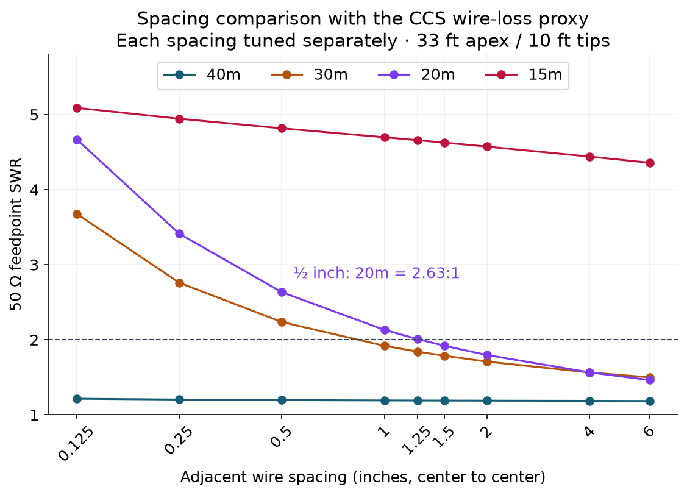
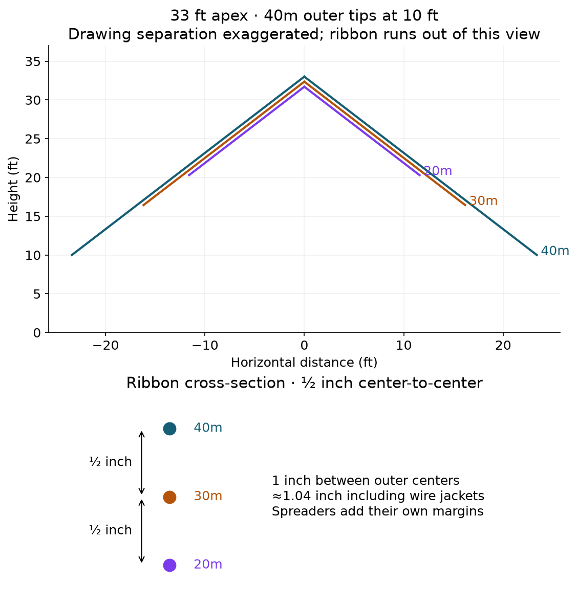
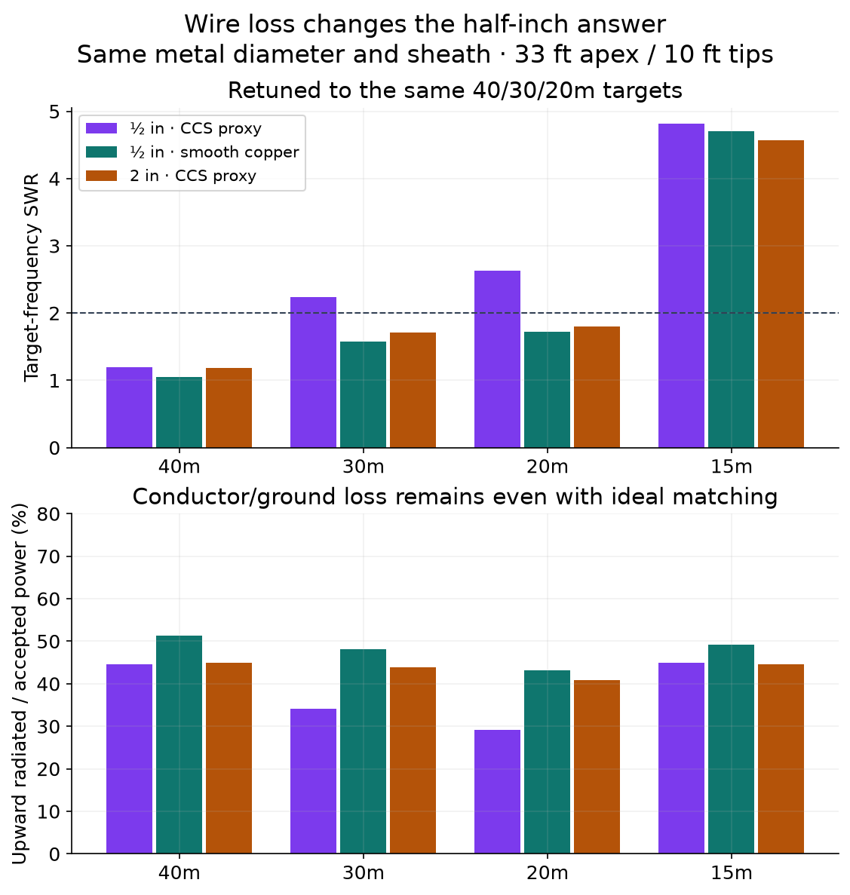
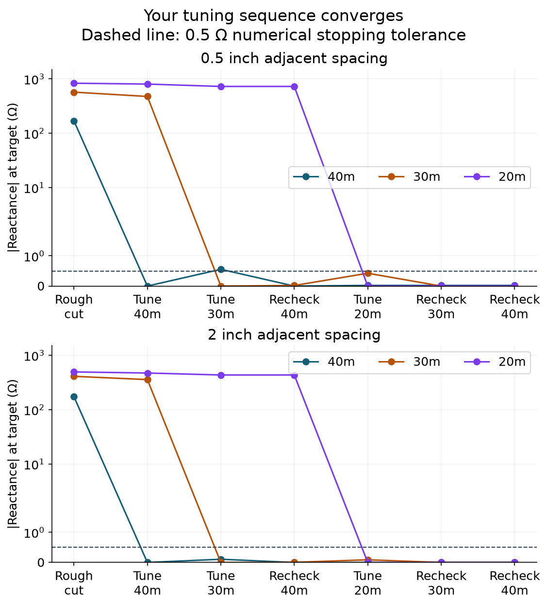
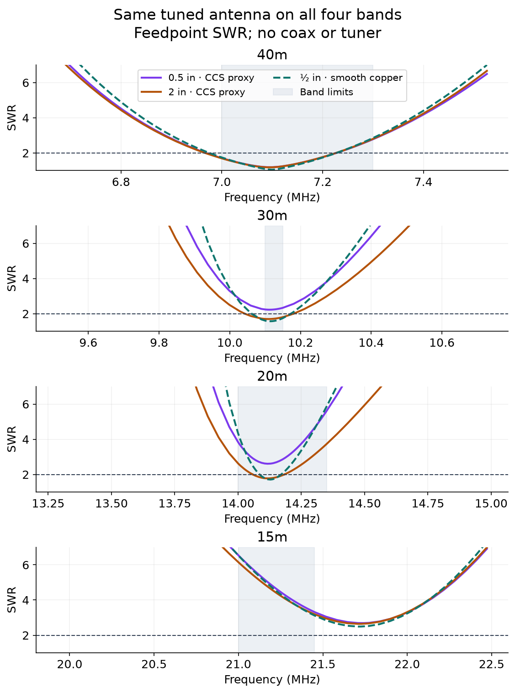
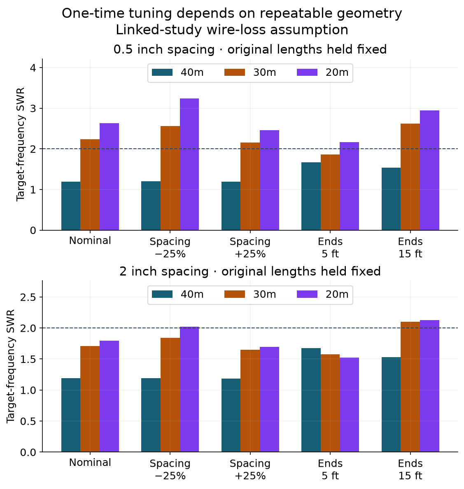

# Backpackable 40/30/20m fan dipole

**Provisional NEC-2 study · 33 ft apex / 10 ft 40m tips · constant parallel spacing · 50 Ω balanced feed.**

## Answer for the build

**Half-inch spacing is tunable. Whether it matches well depends strongly on wire loss.** With the linked study’s 10 MS/m thin-wire loss proxy, the ½-inch resonant feedpoint SWRs are 1.20:1 / 2.24:1 / 2.63:1 on 40/30/20m. The limitation is elevated feed resistance on the shorter bands, more than an endlessly unstable tuning sequence.

**With that same wire-loss assumption, use about 2 inches between adjacent wires for a first low-SWR prototype** (4 inches between outer centers). The smallest tested spacing below 2:1 at all three target frequencies is **1.5 inches**; this is a sampled model boundary with little allowance for construction/site changes, not a universal minimum. Two inches leaves more margin and may suit removable or folding spreaders. If a narrow winder is the priority, **½ inch remains a candidate with matching assistance**, subject to measuring the completed antenna and verifying the actual tuner/feedline. This study does not simulate a specific tuner.

**Half-inch spacing is more promising with lower-loss wire.** The separately retuned, same-diameter smooth-copper comparison is reported below. It changes conductivity, not spacing or jacket dimensions; it is an optimistic material comparator, not a claim that the existing CCS wire behaves like copper. A tuner can address mismatch but cannot recover power dissipated in the wire.

**15m is a useful harmonic to investigate, not a promised fourth matched band.** The ½-inch assembly has 4.82:1 at 21.2 MHz. The full 15m sweep below tests the actual coupled structure after tuning 40/30/20m; no 15m adjustment is made.



## What is physically modeled

All six arms remain connected and deployed on every band. Wires run parallel, with equal adjacent center-to-center spacing everywhere along their overlapping lengths. The 40m wire establishes each straight inverted-V leg; the 30m and 20m wires stop higher along that slope. A horizontal ribbon is assumed. This is not an angular fan with an inch of separation only at its tips.



The ½-inch example has approximately **143.5 ft of radiator wire**, compared with 65.6 ft for its 40m dipole alone (about 2.19× as much). The antenna footprint remains roughly 47 ft tip to tip, before support cords. At half-inch spacing the three-wire ribbon is about 1.04 inches wide including the modeled jackets. No particular winder, spacer mass, bend radius, or packed-volume claim is modeled.

The wire and soil assumptions carry over from the linked-dipole study: 0.2413 mm effective metal radius, 0.5207 mm jacket radius, εr=2.3 sheath approximation, 10 MS/m effective conductivity, and average ground (εr=13, σ=0.005 S/m). Conductivity is an uncalibrated copper-clad-steel loss proxy. Targets are 7.100, 10.120, 14.135 MHz, with 21.200 MHz as the 15m spot check.

## Spacing comparison

Each row is a separately tuned antenna. Wire lengths are frozen for its frequency sweep and subsequent deployment tests.

| Adjacent spacing in | Ribbon outer centers in | SWR 40m | 30m | 20m | 15m |
| --- | --- | --- | --- | --- | --- |
| 0.125 | 0.25 | 1.21 | 3.68 | 4.67 | 5.09 |
| 0.25 | 0.5 | 1.20 | 2.76 | 3.41 | 4.94 |
| 0.5 | 1 | 1.20 | 2.24 | 2.63 | 4.82 |
| 1 | 2 | 1.19 | 1.92 | 2.13 | 4.70 |
| 1.25 | 2.5 | 1.19 | 1.84 | 2.01 | 4.66 |
| 1.5 | 3 | 1.19 | 1.79 | 1.92 | 4.62 |
| 2 | 4 | 1.19 | 1.71 | 1.80 | 4.57 |
| 4 | 8 | 1.19 | 1.56 | 1.57 | 4.44 |
| 6 | 12 | 1.18 | 1.50 | 1.46 | 4.36 |

**Resonance means feedpoint X≈0; match also requires R near 50 Ω.** At ½ inch, modeled resonant resistances are 59.8, 111.8, and 131.6 Ω. Further shortening to chase SWR moves the resonance; it does not independently fix the resistance. Minimum SWR and resonance need not coincide.

## The wire-loss qualification

Close parallel wires carry induced currents as well as their directly driven current. The stronger coupling makes conductor loss important, particularly on the shorter bands. Compare the same metal radius and jacket with conductivity changed from the uncalibrated 10 MS/m CCS proxy to an optimistic 58 MS/m smooth-copper model. Both antennas are separately retuned; these are not frozen-length substitutions.



Upward efficiency integrates the far field over the upper hemisphere and divides by accepted feedpoint power. It includes modeled wire/ground effects and excludes mismatch, coax and tuner loss. A perfect tuner could remove mismatch but would leave this efficiency unchanged. These percentages are particularly dependent on the unknown CCS RF loss and should not be treated as measured antenna efficiencies.

| Material / spacing | SWR 40 / 30 / 20 / 15 | Upward efficiency %: 40 / 30 / 20 / 15 |
| --- | --- | --- |
| CCS proxy / ½ in | 1.20 / 2.24 / 2.63 / 4.82 | 45 / 34 / 29 / 45 |
| Smooth copper / ½ in | 1.05 / 1.58 / 1.73 / 4.70 | 51 / 48 / 43 / 49 |
| CCS proxy / 2 in | 1.19 / 1.71 / 1.80 / 4.57 | 45 / 44 / 41 / 45 |
| Smooth copper / 2 in | 1.05 / 1.34 / 1.35 / 4.47 | 51 / 56 / 54 / 49 |

The half-inch smooth-copper comparison covers **14.0852–14.1705 MHz** on 20m at ≤2:1. Its dimensions and all other band windows are in the material summary and tuning files. If the narrow winder is essential, this is the more useful prototype direction than assuming that additional trimming will cure the existing-wire model. Check actual wire construction/RF resistance and re-run before extending this conclusion to a different gauge or insulation. Copper was retuned at ½ and 2 inches only; a smaller copper minimum is not established.

## Your assembly-and-trim sequence

The simulation starts with **35 / 25 / 18 ft per side** for 40/30/20m, all connected. These are generous straight-wire trial blanks, not verified construction cuts or connector allowances. It tunes 40 → 30 → recheck 40 → 20 → recheck 30 → recheck 40, then checks all three together. Every tested spacing converged in this six-adjustment cycle to |X|≤0.5 Ω at the target frequencies. The search permits both shortening and lengthening; a real analyzer-guided session involves more individual snips/readings.



| Step at ½ inch | Change to each affected leg | Remaining X: 40 / 30 / 20 Ω |
| --- | --- | --- |
| 40m | shorten 26.486 in | -0.00 / 474.28 / 800.88 |
| 30m | shorten 27.778 in | -0.55 / 0.00 / 724.63 |
| 40m | lengthen 0.102 in | 0.00 / 0.02 / 724.90 |
| 20m | shorten 20.878 in | -0.02 / -0.42 / 0.00 |
| 30m | lengthen 0.020 in | -0.02 / 0.00 / -0.00 |
| 40m | no adjustment | -0.02 / 0.00 / -0.00 |

The small positive corrections show why **cut-only tuning is not exactly reversible**. Use adjustable ends or temporary extensions until all three bands are checked. Folded tails have their own capacitance and are not represented by simply shortening a straight wire; finish with the actual tail routing and spreaders in place. Avoid permanent final cuts after the first 40m reading.

### Provisional finished straight lengths, per side

Measured from each feed-bridge edge to the tip; **exclude half of the separate 10 cm source bridge**. Do not use these as exact build cuts. Feed hardware, insulation and tails can shift the required lengths.

| Spacing / material | 40m ft | 30m ft | 20m ft |
| --- | --- | --- | --- |
| 0.5 in / CCS proxy | 32.801 | 22.687 | 16.260 |
| 1.5 in / CCS proxy | 32.819 | 22.948 | 16.434 |
| 2 in / CCS proxy | 32.823 | 22.994 | 16.467 |
| 0.5 in / smooth copper | 32.902 | 22.803 | 16.324 |
| 2 in / smooth copper | 32.919 | 23.077 | 16.514 |

### Local interaction after tuning

The table gives the predicted resonance shift in kHz after **shortening both ends of one pair by 1 inch each**, with the other wire lengths fixed. Values are local derivatives at the tuned ½-inch model, not a large-trim rule. The 40m-tip height stays at 10 ft, so adjusting its length also slightly changes the slope of all branches.

| Band whose resonance moves | Trim 40m pair | Trim 30m pair | Trim 20m pair |
| --- | --- | --- | --- |
| 40m | +19.1 | +0.1 | +0.0 |
| 30m | +0.3 | +37.3 | +0.0 |
| 20m | +0.0 | +0.0 | +72.3 |

## Bandwidth and the 15m harmonic

The gray regions are band boundaries; curves extend beyond them to show the resonance. The table reports only in-band intervals with SWR≤2:1, refined at the crossings. The table uses the linked-study wire-loss proxy; the dashed copper curve has separate windows in the material summary. These are feedpoint values; coax can transform the measured impedance and add loss.



| Spacing in | Band | Nearest X=0 MHz | In-band ≤2:1 MHz | Worst sampled in-band SWR |
| --- | --- | --- | --- | --- |
| 0.5 | 40m | 7.1001 | 7.0000–7.2268 | 2.78 |
| 0.5 | 30m | 10.1200 | none | 2.34 |
| 0.5 | 20m | 14.1350 | none | 5.62 |
| 0.5 | 15m | 21.7427 | none | 6.54 |
| 2 | 40m | 7.1000 | 7.0000–7.2262 | 2.80 |
| 2 | 30m | 10.1200 | 10.1000–10.1500 | 1.81 |
| 2 | 20m | 14.1350 | 14.0583–14.1826 | 3.74 |
| 2 | 15m | 21.7291 | none | 6.15 |

A 40m dipole supports a higher odd-order mode near 15m, but the resonances are not an exact 3:1 frequency scaling once end effects, insulation, ground and the other wires are included. The mode also has a different radiation pattern. This study establishes feedpoint matching behavior, not contact probability or a 15m efficiency advantage over a dedicated element.

## Can the tuning remain a one-time job?

Yes in a repeatable mechanical geometry; that premise is worth testing in the field. All following variants keep the originally tuned lengths. Spacing ±25% is a uniform change over the whole ribbon, not a prediction of random sag, touching wires or twisted sections. Tip-height changes reset the straight-leg slope.



| Spacing in | Deployment | SWR 40 / 30 / 20 |
| --- | --- | --- |
| 0.5 | spacing -25% | 1.20 / 2.56 / 3.24 |
| 0.5 | spacing +25% | 1.19 / 2.15 / 2.46 |
| 0.5 | ends 5 ft | 1.67 / 1.86 / 2.16 |
| 0.5 | ends 15 ft | 1.54 / 2.62 / 2.95 |
| 2 | spacing -25% | 1.19 / 1.84 / 2.02 |
| 2 | spacing +25% | 1.19 / 1.65 / 1.70 |
| 2 | ends 5 ft | 1.68 / 1.57 / 1.52 |
| 2 | ends 15 ft | 1.53 / 2.10 / 2.13 |

The retuned **½-inch smooth-copper** comparator with its own lengths held fixed:

| Deployment | SWR 40 / 30 / 20 |
| --- | --- |
| spacing -25% | 1.05 / 1.94 / 2.37 |
| spacing +25% | 1.05 / 1.59 / 1.73 |
| ends 5 ft | 1.89 / 1.58 / 1.49 |
| ends 15 ft | 1.41 / 1.97 / 2.04 |

Maintain the chosen spacing along the overlap, particularly near the shorter-wire tips. Keep all six wires under repeatable tension; let nonconductive extensions carry the short-wire ends toward the same outer supports. Removable spreaders can reduce the width while winding. The study does not establish a required distance between spreaders; that needs a mechanical sag/tension test.

The CSV also includes poor/good ground, no-sheath and 1.5× sheath-loading variants, and a solid-copper conductivity proxy at ½ and 2 inches. These are exploratory one-variable changes, not a statistical error bar. The sheath approximation changes electrical length but does not rigorously solve the dielectric field between closely coupled insulated wires.

## Numerical verification and limits

**315/324 numerical checks pass the declared limits.** Largest primary-to-fine ΔZ: 7.685 Ω. Largest lossless average-gain error: 0.104 dB.

**The sub-half-inch results are exploratory trends.** The ⅛- and ¼-inch meshes fail the 2 Ω convergence limit on 30/20m; the ¼-inch fine-mesh bare 30m average gain narrowly exceeds 0.10 dB. At ½ inch, the mesh and average-gain checks pass, but varying the source bridge changes 30m impedance by about 2.1 Ω and 20m by about 5.3 Ω, exceeding the separate 2 Ω source check. The 2-inch references pass all these checks. The half-inch copper source variation similarly exceeds the 2 Ω limit: 2.2 Ω on 30m and 5.8 Ω on 20m. These uncertainties are small relative to the half-inch shorter-band resistance excess, but do not justify an exact minimum-spacing or cutting claim.

Parallel wires have matching segment boundaries, with local refinement at every short-wire tip on all neighboring wires. Long-segment caps are 0.18 / 0.12 / 0.08 m; the primary mesh is 0.12 m. Source bridges contain nine equal segments. All nine spacings and four bands receive mesh and bare/coated lossless full-sphere power checks; the two retuned copper comparators receive the same mesh/power checks. Declared limits are 2 Ω for primary→fine impedance and 0.10 dB for average gain. Feed-bridge lengths of 6/10/14 cm are checked at ½ and 2 inches while keeping total conductor path fixed.

The common balanced port is represented by **three equal in-phase 1 V sources**, one per dipole pair. The solver includes mutual coupling among every wire. Total port impedance is 1 / Σ(1/Zsource), using NEC’s complex per-source impedances; source power is independently checked against ½ Re(1/Ztotal). This represents ideal equipotential feed terminals without finite lead/bus parasitics. It is not three separately simulated impedances connected afterward. An optional physical-bus topology is retained for diagnostics; coarse trial bus models failed power checks and are not used for conclusions.

Numerical checks validate this idealized formulation, not the real antenna. Feed hardware, coax/common-mode current, choke, mast, people, vegetation, sloping ground, dielectric spacer loading, wet insulation, sag/twist and folded tails are absent. Wire loss uses a homogeneous effective conductivity without a full stranded/plated or circumferential proximity-current model. Exact fractions of an inch and hundredths of SWR are computational detail, not promised field precision.

### Prototype procedure

1. Build all three pairs long with adjustable tips. Install the intended feed hardware and spreaders first.
2. Raise to 33 ft / 10 ft and measure calibrated feedpoint R+jX sweeps. Tune 40 → 30 → 40 → 20 → 30 → 40.
3. Record final R as well as X. If the shorter bands are resonant but high in resistance, widen spacing or evaluate lower-loss wire or a matching solution; repeated trimming is not an independent resistance control.
4. Sweep all of 15m. Then pack, unwind and redeploy several times; compare resonance and SWR before making final cuts.
5. Repeat at practical tip heights and with actual coax/choke. If measurements are through coax, record/de-embed it before comparing to these feedpoint results.

## Reproduce and inspect

```bash
uv sync --no-editable --extra plots --group dev
NEC2C_PATH=build/tools/nec2c mise run fan-dipole
mise run check
```

The task regenerates the full data and report under `build/fan-dipole-v1/` and the compact checked-in package here. Raw NEC decks/outputs remain in `build/fan-dipole-cache/`; exact deck/output and solver hashes are retained in full-run metadata. Both result packages have verified recursive SHA256 manifests.

- [Configuration](config.json) · [Summary CSV](summary.csv) · [All SWR samples](sweeps.csv)
- [Sequential tuning history](tuning.json) · [Interaction derivatives](jacobians.json)
- [Retuned copper comparison](material_summary.csv) · [Copper tuning history](material_tuning.json) · [Copper redeployment](material_sensitivity.csv)
- [Deployment/material sensitivity](sensitivity.csv) · [Numerical checks](validation.json)
- [Run provenance](run_metadata.json) · [Full-run manifest identity](full_run.json)

### Method sources

- [NEC-2 user guide, wire-modeling rules](https://www.nec2.org/other/nec2prt3.pdf): close parallel segments must align; check mesh dependence and wire/source geometry.
- [Cebik’s thin-sheath series-inductance approximation](https://hamwaves.com/wire/doc/Insulated%20Wires:%20The%20NEC-2%20Way.html): approximate insulation loading, not a full coupled-dielectric solution.
- [Linked-dipole reference](../linked-dipole-v1/README.md) and [power normalization audit](../../docs/linked-dipole-power-audit.md).
