# Portable 20/30/40m linked dipole

**Provisional NEC-2 study · 33 ft feedpoint · all three sections deployed on every band.**

## Tune once, then deploy it

**Use 33 ft at the feedpoint and 10 ft at the outer 40m wire ends as the default tuning setup. Then keep the same wire lengths when changing deployment height.** Retuning for each height is optional; the primary comparison below uses one unchanged antenna. The separate retuned comparison explains what further adjustments could recover and is not an operating requirement.

### Initial wire cuts, per leg

| Section | Initial construction choice | Nominal modeled dimension |
| --- | --- | --- |
| 20m | Preserve the existing tuned legs and folds | 16.661 ft |
| 30m extension | 8 ft raw blank | 6.524 ft |
| 40m extension | 11 ft 6 in raw blank | 9.635 ft |

Cut two of each new extension blank, one for each leg. **Do not cut the wire directly to the modeled dimensions.** The blanks include tuning allowance; the model dimensions run between link centers and a separate feed bridge, and omit the actual threading, folds and connector tails. Preserve the existing 20m adjustment first, then recheck it with the disconnected extensions physically deployed. Finish tuning in 20/30/40m order and leave the resulting lengths fixed.

### Fixed-wire SWR when the outer ends move

These are feedpoint SWRs at the intended operating frequencies, using average ground and the same nominal assembly in every row.

| Outer ends ft | 20m · 14.135 MHz | 30m · 10.12 MHz | 40m · 7.1 MHz |
| --- | --- | --- | --- |
| 5 | 1.87:1 | 1.85:1 | 1.72:1 |
| 10 **default** | 1.06:1 | 1.20:1 | 1.15:1 |
| 15 | 1.40:1 | 1.59:1 | 1.49:1 |
| 20 | 1.62:1 | 1.86:1 | 1.75:1 |
| 33 | 1.81:1 | 2.05:1 | 1.99:1 |

The largest target-frequency SWR in this comparison is **2.05:1**, with at most **0.55 dB** of 50 Ω source mismatch loss. For perspective, 2:1 SWR means 0.51 dB of mismatch loss; it does not by itself require changing the wire. Actual radio power reduction and additional coax loss are not modeled. These spot-frequency results do not promise the same match across an entire band: the full SWR windows are shown below.

## Field recommendation

- **20m:** 10–15 ft outer ends are a useful compromise. Raising farther improves lower-angle broadside radiation, but reduces very-high-angle radiation. The steep 5 ft setup remains a practical compact option; it is not uniformly worse in every direction.
- **30m:** aim for 10–15 ft ends when convenient. This recovers much of the useful gain while retaining strong high-angle coverage. Check the match after changing shape: this narrow band can sit above the shifted SWR minimum.
- **40m:** give the ends as much height as practical, preferably 15–20 ft or a flat top. The steep setup has a meaningful penalty in both upward power and gain, including high-angle regional coverage. Even a rise to 10 ft helps substantially.

These are relative antenna-model conclusions, not guaranteed contact distances. Propagation, noise, station orientation and the actual feed system still matter.

Download [the self-contained viewer](viewer.html) and open it locally, or use **`mise run linked-dipole-viewer`** from the repository. GitHub displays HTML source rather than running the viewer. It selects band, deployment, frozen/retuned lengths and accepted/realized gain, and exports SVG charts. The [artifact index](#saved-artifacts) links the maintained results; complete solver runs remain under `build/linked-dipole-v1/`.

## Read the radiation shape at a glance

The bold curves show the **10 ft default outer ends**; gray dashed curves show the flat top. Each row is one band, with a broadside vertical slice on the left and a horizontal-direction sweep at 20° elevation on the right. These use the same frozen wire lengths.

[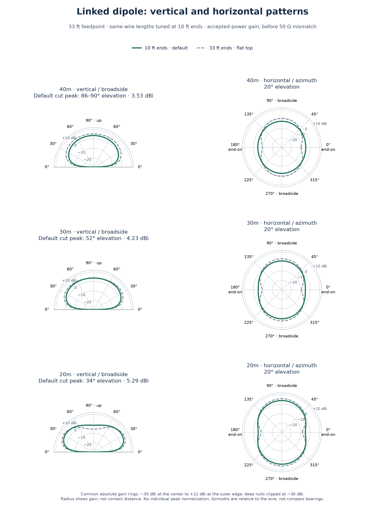](figures/polar_default_accepted.png)

[Download PNG](figures/polar_default_accepted.png) · [Download SVG](figures/polar_default_accepted.svg)

**Read outward as stronger radiation in that direction.** The rings show absolute gain from −30 to +12 dBi on the same scale in every panel; the curves are not rescaled to their own peaks. The drawing shows gain, not contact distance or the antenna's physical shape. Deep nulls below −30 dBi meet the plot floor. A labeled peak-angle range identifies tied maxima in the 2° samples after solver rounding; it does not describe the width of the lobe.

In a vertical slice, the horizontal baseline is the horizon and the top is straight overhead (90° elevation). The two halves use computed samples in opposite azimuth directions; nothing below ground is drawn. The broadside slice has azimuth 90° on the right and 270° on the left. In a horizontal-direction sweep, 0°/180° are along the wire span (end-on), and 90°/270° are perpendicular to it (broadside). These are directions relative to the antenna, not compass bearings. A horizontal sweep holds elevation above the horizon fixed: a literal 0° horizon cut is an unhelpful null in this ground model.

This first figure uses accepted-power gain: it includes the modeled wire and ground effects. Realized-gain figures below also apply the 50 Ω source mismatch once. The viewer lets you switch between these references and inspect another band or deployment.

## The same physical antenna, five shapes

[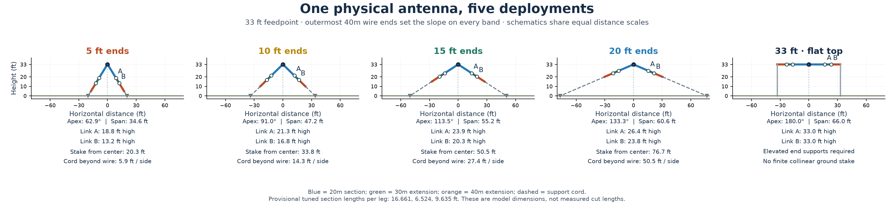](figures/geometry_comparison.png)

[Download PNG](figures/geometry_comparison.png) · [Download SVG](figures/geometry_comparison.svg)

The nominal assembly was tuned **sequentially on 20, 30, then 40m at 33/10 ft**, then every band was rechecked and the sequence repeated until |X| ≤ 0.15 Ω. It took 2 passes. The resulting modeled sections per leg are **16.661 + 6.524 + 9.635 ft**. These are electrical model dimensions, **not measured cuts or cutting instructions**. The 8 ft and 11 ft 6 in extension blanks include tuning allowance. Folded ends, wire threading and connector tails can change the required physical lengths.

A separate 10 cm ideal-feed bridge is included; the section lengths start at its edges and end at link centers or the outer wire tip. The included angle describes the two straight leg directions. All outer 40m ends stay at the specified height, including on 20/30m. Link heights follow their fractional distance down the full slope.

The ideal-feed bridge has three equal segments, with the middle segment excited. Short neighboring leg segments increase gradually toward the normal wire mesh. This keeps the source's immediate neighbors collinear and improves numerical convergence without changing the physical wire path or link positions.

| Outer ends ft | Apex | Wire span ft | A height ft | B height ft | Center→stake ft, each side | Cord ft, each side |
| --- | --- | --- | --- | --- | --- | --- |
| 5 | 62.9° | 34.6 | 18.8 | 13.2 | 20.3 | 5.9 |
| 10 | 91.0° | 47.2 | 21.3 | 16.8 | 33.8 | 14.3 |
| 15 | 113.5° | 55.2 | 23.9 | 20.3 | 50.5 | 27.4 |
| 20 | 133.3° | 60.6 | 26.4 | 23.8 | 76.7 | 50.5 |
| 33 | 180.0° | 66.0 | 33.0 | 33.0 | elevated supports | — |

Cords continue along the wire slope to level ground. These are straight-line lengths before knots, sag or stretch; double the stake distance for the total footprint. At 20 ft ends this requires a large clearing. Elevated end supports can avoid that long ground-stake extension. A flat top cannot reach ground with a horizontal cord.

## Frozen lengths: impedance, match and power

All values below use the same nominal lengths, average ground and the target frequency in the band label. **η↑** is accepted feedpoint power reaching the upper-hemisphere far field. Mismatch loss is separate. **Gain** already includes the modeled material and ground effects; **realized gain** additionally includes the 50 Ω source mismatch exactly once. Peak direction uses elevation/azimuth; azimuth 0° is along the wire span (end-on), 90° is broadside. Symmetric opposite directions have the same gain, and azimuth is immaterial at zenith.

| Band (MHz) | Ends ft | Feedpoint Ω | SWR50 | η↑ % | Mismatch dB | Peak dBi | Peak el/az | Realized peak dBi |
| --- | --- | --- | --- | --- | --- | --- | --- | --- |
| 20m (14.135) | 5 | 33.7-20.4j | 1.87 | 53.3 | 0.42 | 4.43 | 34°/88° | 4.01 |
| 30m (10.12) | 5 | 37.9-24.4j | 1.85 | 49.8 | 0.41 | 3.27 | 54°/90° | 2.86 |
| 40m (7.1) | 5 | 39.9-22.4j | 1.72 | 33.9 | 0.32 | 1.94 | 90°/0° | 1.62 |
| 20m (14.135) | 10 | 52.9-0.0j | 1.06 | 60.8 | 0.00 | 5.29 | 34°/90° | 5.29 |
| 30m (10.12) | 10 | 59.8-0.0j | 1.20 | 59.3 | 0.03 | 4.23 | 52°/90° | 4.20 |
| 40m (7.1) | 10 | 57.3-0.0j | 1.15 | 45.7 | 0.02 | 3.53 | 90°/0° | 3.51 |
| 20m (14.135) | 15 | 66.1+10.7j | 1.40 | 64.2 | 0.12 | 5.78 | 32°/90° | 5.66 |
| 30m (10.12) | 15 | 75.6+12.7j | 1.59 | 64.3 | 0.23 | 4.75 | 50°/90° | 4.52 |
| 40m (7.1) | 15 | 69.8+12.8j | 1.49 | 53.5 | 0.17 | 4.41 | 90°/0° | 4.24 |
| 20m (14.135) | 20 | 74.6+16.9j | 1.62 | 66.0 | 0.25 | 6.13 | 32°/88° | 5.88 |
| 30m (10.12) | 20 | 86.5+19.3j | 1.86 | 67.5 | 0.41 | 5.09 | 48°/88° | 4.68 |
| 40m (7.1) | 20 | 79.1+20.3j | 1.75 | 59.1 | 0.33 | 4.94 | 90°/0° | 4.61 |
| 20m (14.135) | 33 | 80.2+23.3j | 1.81 | 67.2 | 0.38 | 6.67 | 30°/90° | 6.29 |
| 30m (10.12) | 33 | 95.9+21.8j | 2.05 | 71.0 | 0.55 | 5.56 | 42°/88° | 5.01 |
| 40m (7.1) | 33 | 90.4+24.3j | 1.99 | 66.9 | 0.50 | 5.42 | 68°/86° | 4.92 |

[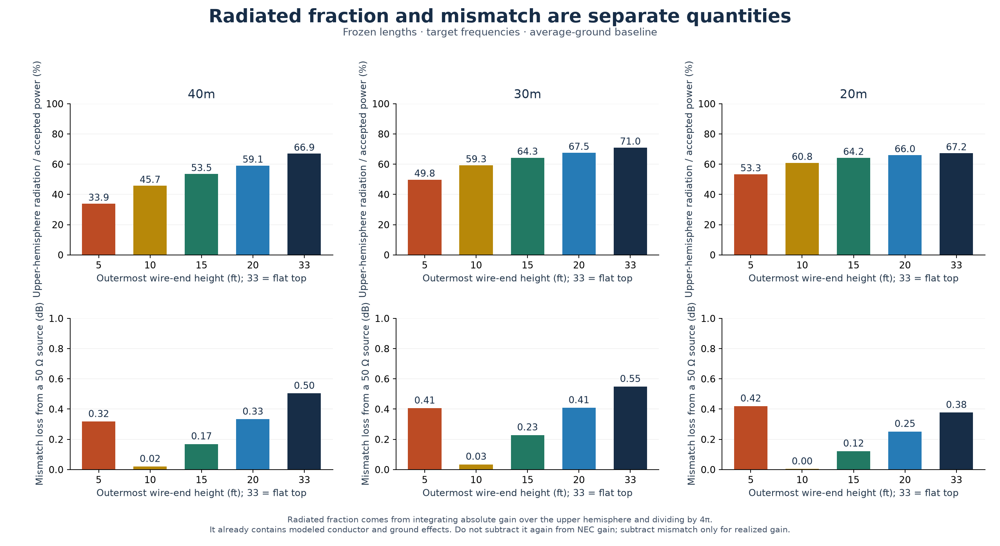](figures/efficiency_mismatch.png)

[Download PNG](figures/efficiency_mismatch.png) · [Download SVG](figures/efficiency_mismatch.svg)

## What each rise buys, and how close it gets to flat

These are **realized broadside gains at 20° elevation**, at the target frequency with frozen lengths. Positive improvements mean more power in that direction. This is one useful lower-angle comparison, not an all-direction ranking.

| Band | Ends ft | Gain dBi | Change from 5 ft dB | Below flat dB |
| --- | --- | --- | --- | --- |
| 20m | 5 | 2.39 | +0.00 | 2.96 |
| 20m | 10 | 3.78 | +1.39 | 1.58 |
| 20m | 15 | 4.28 | +1.89 | 1.07 |
| 20m | 20 | 4.63 | +2.24 | 0.72 |
| 20m | 33 | 5.35 | +2.96 | 0.00 |
| 30m | 5 | -0.87 | +0.00 | 3.30 |
| 30m | 10 | 0.65 | +1.51 | 1.79 |
| 30m | 15 | 1.16 | +2.03 | 1.27 |
| 30m | 20 | 1.54 | +2.41 | 0.89 |
| 30m | 33 | 2.43 | +3.30 | 0.00 |
| 40m | 5 | -4.43 | +0.00 | 4.69 |
| 40m | 10 | -2.40 | +2.03 | 2.67 |
| 40m | 15 | -1.48 | +2.95 | 1.75 |
| 40m | 20 | -0.86 | +3.56 | 1.13 |
| 40m | 33 | 0.27 | +4.69 | 0.00 |

The first 5 ft rise produces **1.39 dB on 20m**, **1.51 dB on 30m**, **2.03 dB on 40m**. The successive 5 ft rises through 20 ft add progressively less at this angle. At 20 ft ends the remaining gap to flat is 0.72 dB on 20m, 0.89 dB on 30m, 1.13 dB on 40m.

## Directional patterns and high-angle coverage

For most compared lower-angle cases, place the wire span perpendicular to the desired bearing so the path is broadside. Inspect the azimuth cut: 40m with 5 ft ends at 10° elevation is an exception, favoring end-on by 1.65 dB. Flatter deployments deepen lower-angle end-on minima on all three bands. A steep V can therefore beat the flat top along the wire span even while radiating less total power upward. Compare the direction you need, not only the peak gain.

### Polar comparisons: all five deployments

The vertical cuts show broadside and end-on slices; the horizontal sweeps hold elevation at 20° and 60°. Every polar panel shares the −30 to +12 dBi rings used above. Compare both the outward reach and the angle of a lobe: a taller lobe in one direction can accompany a deeper null elsewhere.

[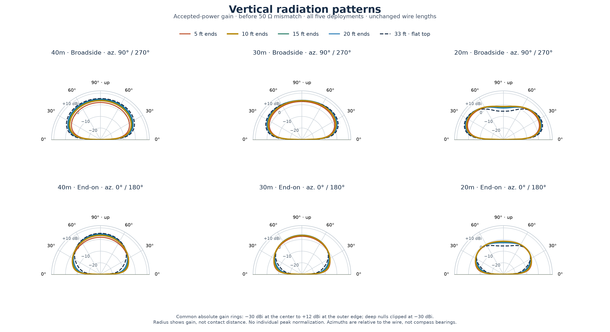](figures/polar_elevation_accepted.png)

[Download PNG](figures/polar_elevation_accepted.png) · [Download SVG](figures/polar_elevation_accepted.svg)

[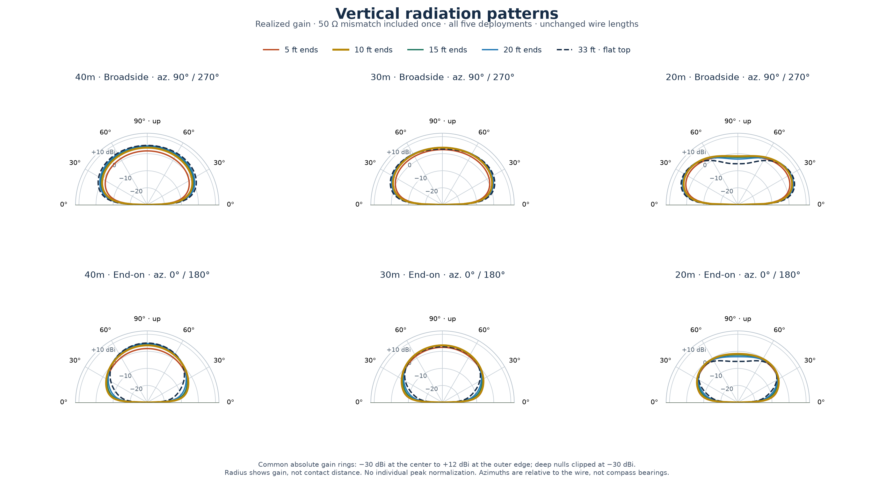](figures/polar_elevation_realized.png)

[Download PNG](figures/polar_elevation_realized.png) · [Download SVG](figures/polar_elevation_realized.svg)

[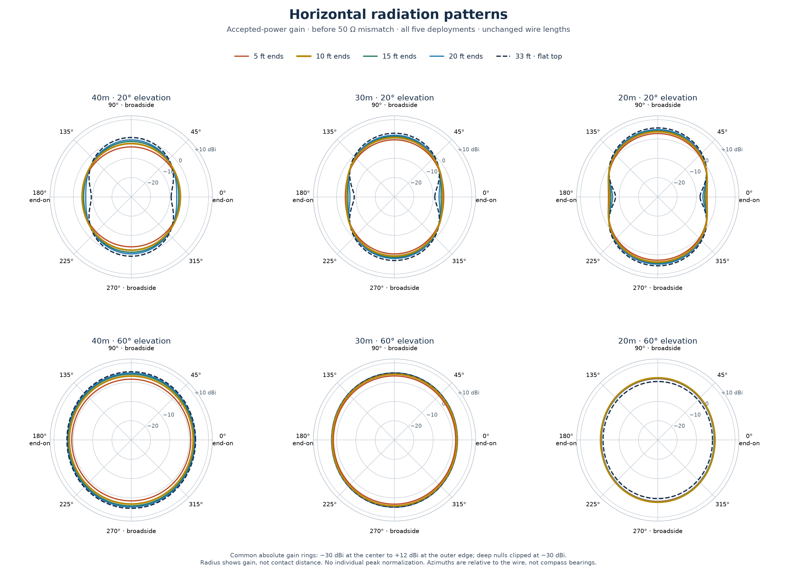](figures/polar_azimuth_accepted.png)

[Download PNG](figures/polar_azimuth_accepted.png) · [Download SVG](figures/polar_azimuth_accepted.svg)

[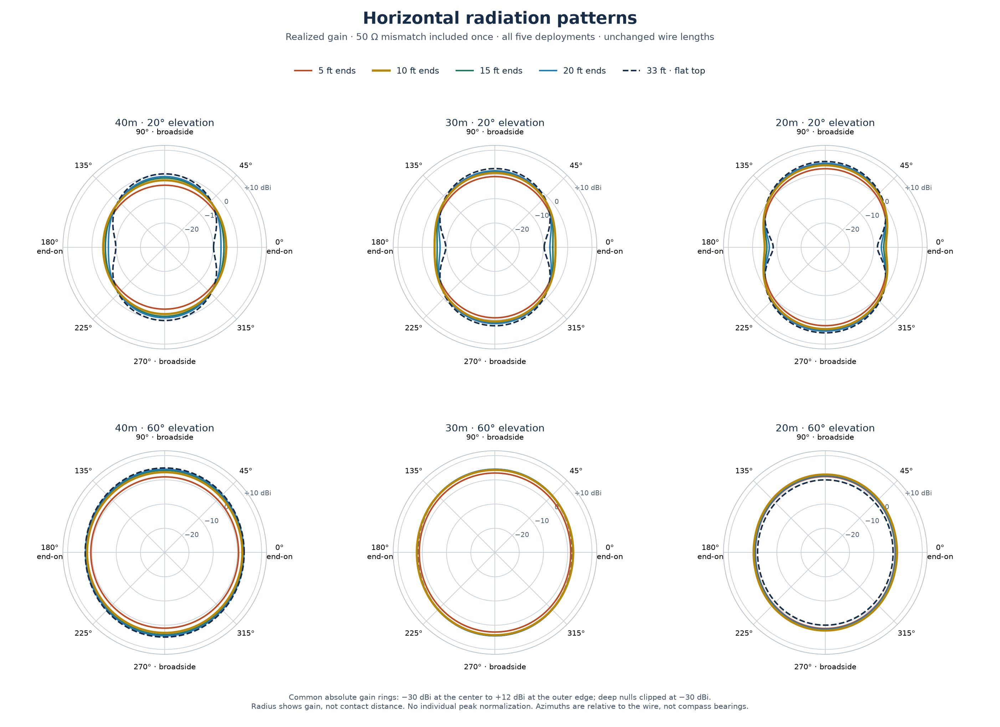](figures/polar_azimuth_realized.png)

[Download PNG](figures/polar_azimuth_realized.png) · [Download SVG](figures/polar_azimuth_realized.svg)

### Detailed angle-versus-gain charts

These charts show the same computed samples with angle along the horizontal axis, which makes exact gain differences easier to read.

[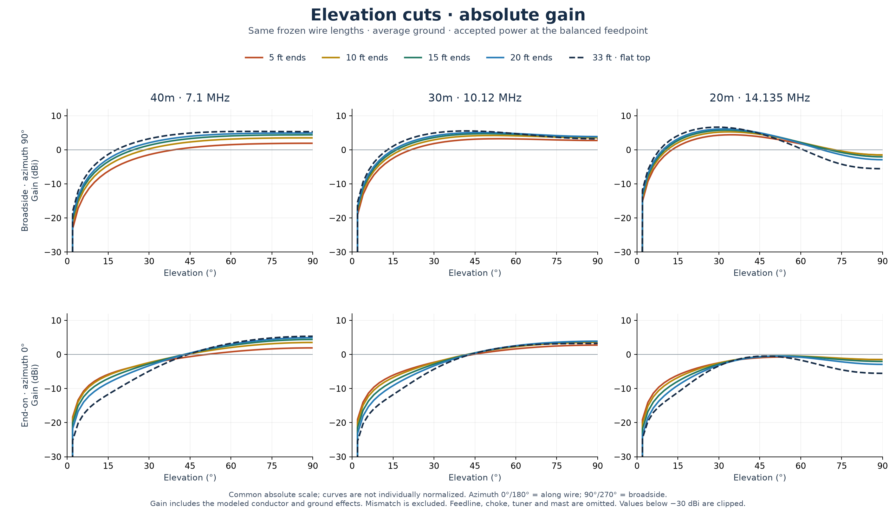](figures/elevation_accepted.png)

[Download PNG](figures/elevation_accepted.png) · [Download SVG](figures/elevation_accepted.svg)

[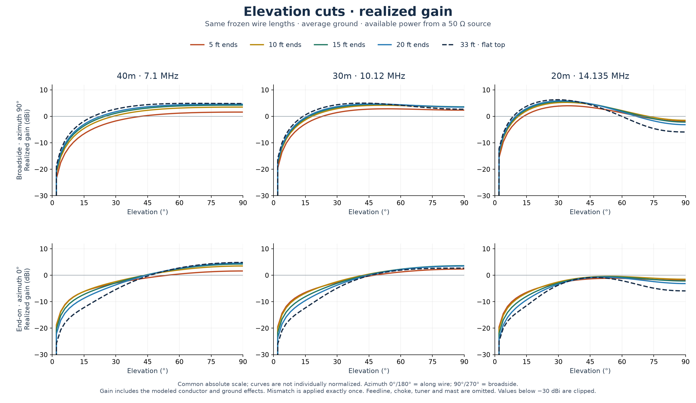](figures/elevation_realized.png)

[Download PNG](figures/elevation_realized.png) · [Download SVG](figures/elevation_realized.svg)

[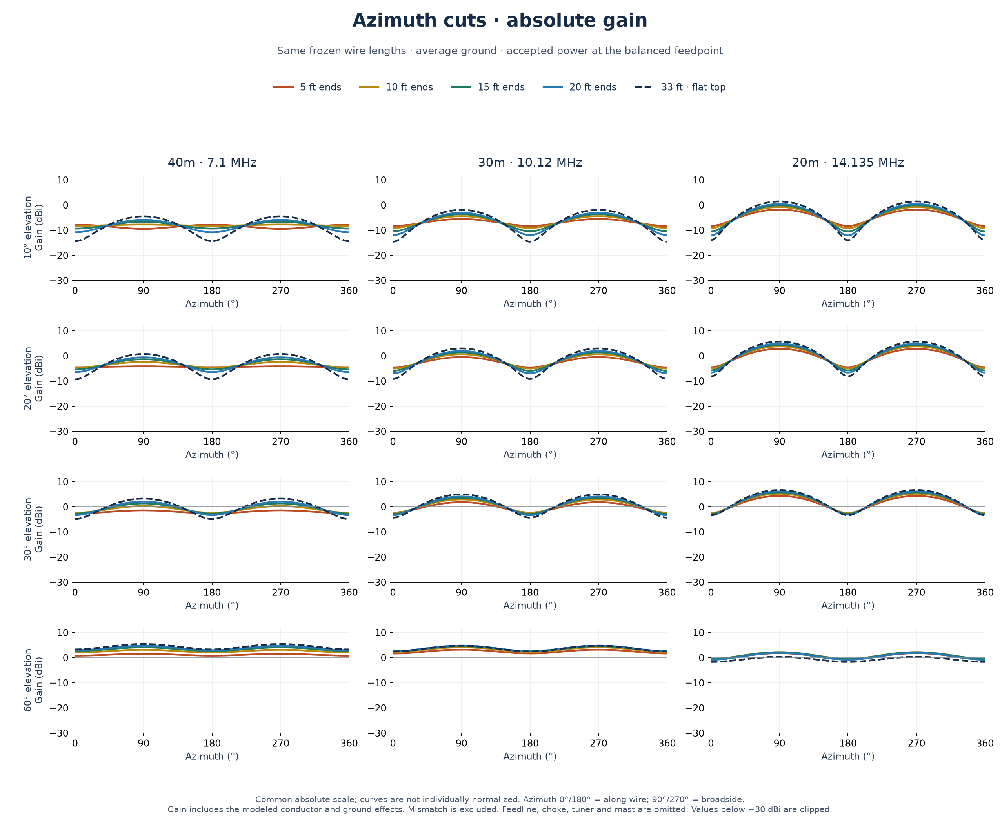](figures/azimuth_accepted.png)

[Download PNG](figures/azimuth_accepted.png) · [Download SVG](figures/azimuth_accepted.svg)

[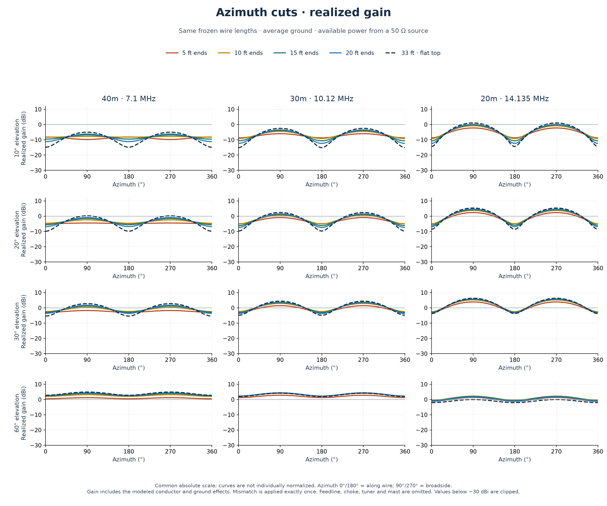](figures/azimuth_realized.png)

[Download PNG](figures/azimuth_realized.png) · [Download SVG](figures/azimuth_realized.svg)

Each group of detailed panels uses a common absolute dBi scale. Curves are not individually normalized. The saved azimuth cuts include 10°, 20°, 30° and 60° elevations. The plot floor clips deep nulls for readability; full computed samples are retained.

For high-angle regional paths, inspect 60° and 90°, not just the peak. On 20m, going 5 ft→flat changes realized 20° broadside gain by +2.96 dB, but 60° by -1.38 dB and zenith by -4.01 dB. The broadside lobe moves lower. On 30m the pattern remains useful at medium/high angles. On 40m the same change adds 3.67 dB at 60°; its 33 ft center is still low in wavelengths, so strong high-angle radiation persists. Raising the ends helps lower-angle 40m radiation without turning this into a predominantly low-angle antenna.

### Gain at the requested elevations

Each cell is **broadside / end-on accepted-power gain in dBi**. To obtain realized gain at any listed direction, subtract that row's mismatch loss from the earlier table. Both quantities are also explicit columns in `summary.csv` and the viewer.

| Band | Ends ft | 10° B/E | 20° B/E | 30° B/E | 60° B/E | 90° B/E |
| --- | --- | --- | --- | --- | --- | --- |
| 20m | 5 | -1.80 / -8.27 | 2.81 / -4.49 | 4.30 / -2.45 | 1.77 / -0.76 | -1.48 / -1.48 |
| 30m | 5 | -5.56 / -8.28 | -0.46 / -4.54 | 1.85 / -2.29 | 3.21 / 1.65 | 2.76 / 2.76 |
| 40m | 5 | -9.49 / -7.84 | -4.11 / -4.49 | -1.41 / -2.63 | 1.53 / 0.79 | 1.94 / 1.94 |
| 20m | 10 | -0.78 / -9.19 | 3.78 / -4.98 | 5.20 / -2.51 | 2.20 / -0.49 | -1.49 / -1.49 |
| 30m | 10 | -4.41 / -9.10 | 0.68 / -5.03 | 2.94 / -2.39 | 4.12 / 2.28 | 3.56 / 3.56 |
| 40m | 10 | -7.74 / -8.24 | -2.38 / -4.61 | 0.30 / -2.37 | 3.16 / 2.04 | 3.53 / 3.53 |
| 20m | 15 | -0.12 / -10.56 | 4.40 / -5.78 | 5.73 / -2.82 | 2.17 / -0.58 | -2.04 / -2.04 |
| 30m | 15 | -3.66 / -10.42 | 1.39 / -5.92 | 3.61 / -2.83 | 4.57 / 2.51 | 3.85 / 3.85 |
| 40m | 15 | -6.65 / -9.36 | -1.31 / -5.39 | 1.34 / -2.72 | 4.10 / 2.64 | 4.41 / 4.41 |
| 20m | 20 | 0.42 / -12.11 | 4.88 / -6.63 | 6.11 / -3.12 | 1.91 / -0.80 | -2.89 / -2.89 |
| 30m | 20 | -3.07 / -11.93 | 1.95 / -6.93 | 4.11 / -3.34 | 4.79 / 2.58 | 3.90 / 3.90 |
| 40m | 20 | -5.86 / -10.83 | -0.53 / -6.44 | 2.09 / -3.29 | 4.70 / 2.98 | 4.94 / 4.94 |
| 20m | 33 | 1.44 / -13.99 | 5.73 / -8.13 | 6.67 / -3.34 | 0.35 / -1.67 | -5.53 / -5.53 |
| 30m | 33 | -1.93 / -14.57 | 2.98 / -9.15 | 4.95 / -4.32 | 4.75 / 2.49 | 3.25 / 3.25 |
| 40m | 33 | -4.48 / -14.35 | 0.77 / -9.33 | 3.27 / -4.88 | 5.39 / 3.28 | 5.35 / 5.35 |

## Reduced loss versus redistribution

At a fixed direction, Δgain = **10 log₁₀(η↑₂/η↑₁)** plus the change in pattern shape after division by η↑. Realized gain then subtracts the change in mismatch loss. This decomposition does not apply efficiency to gain twice.

Opening the V raises more of the current-carrying wire and increases its horizontal span. The model's feed resistance rises: less of the accepted power is spent heating the same thin wire and contacts. Ground-related loss is also reduced most clearly on 40m, whose active wire extends all the way to the low outer tips. On 20m, the active tips are already about 19 ft high in the steep setup; much of the extra broadside gain comes from moving radiation toward lower elevations.

[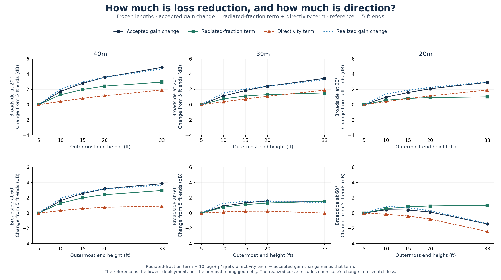](figures/gain_decomposition.png)

[Download PNG](figures/gain_decomposition.png) · [Download SVG](figures/gain_decomposition.svg)

| 5 ft→flat | Upward-efficiency contribution dB | 20° shape contribution dB | Mismatch contribution dB | Net realized 20° change dB |
| --- | --- | --- | --- | --- |
| 20m | +1.01 | +1.91 | +0.04 | +2.96 |
| 30m | +1.54 | +1.90 | -0.14 | +3.30 |
| 40m | +2.96 | +1.92 | -0.19 | +4.69 |

The power ledger below is a fraction of accepted feedpoint power. Structure loss includes wire and closed-contact dissipation. The residual is power absent from upper space waves and explicit NEC dissipation: it is consistent with ground/environmental absorption plus numerical error, **not an independent volume integral of soil heating**.

| Band | Ends ft | Upward % | Structure/contact % | Ground/numerical residual % | NEC printed efficiency % |
| --- | --- | --- | --- | --- | --- |
| 20m | 5 | 53.3 | 23.8 | 22.8 | 76.2 |
| 30m | 5 | 49.8 | 24.9 | 25.3 | 75.1 |
| 40m | 5 | 33.9 | 28.2 | 37.9 | 71.8 |
| 20m | 33 | 67.2 | 10.3 | 22.4 | 89.7 |
| 30m | 33 | 71.0 | 10.1 | 18.9 | 89.9 |
| 40m | 33 | 66.9 | 12.8 | 20.3 | 87.2 |

## Resonance and usable bandwidth without retuning

[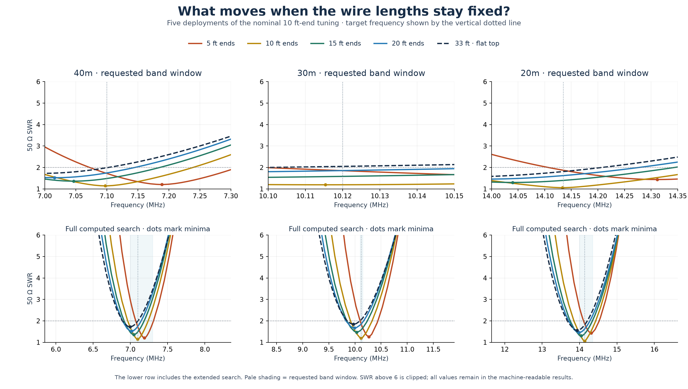](figures/swr_comparison.png)

[Download PNG](figures/swr_comparison.png) · [Download SVG](figures/swr_comparison.svg)

Resonance means X=0 nearest the intended band; minimum SWR need not occur at resonance because R also changes with frequency. Every band has 31 in-band samples plus an extended search, refined minima and 2:1 crossings. The table's 2:1 interval is the full local matched window, including out-of-band frequencies; only its intersection with the intended band is a usable in-band window. 2:1 is a comparison threshold, not a transmitter power-foldback specification.

| Band | Ends ft | Resonance MHz | SWR minimum MHz / value | 2:1 window MHz | Width kHz | In-band ≤2:1 MHz |
| --- | --- | --- | --- | --- | --- | --- |
| 20m | 5 | 14.3044 | 14.3117 / 1.44 | 14.1070–14.5246 | 418 | 14.1070–14.3500 |
| 30m | 5 | 10.2602 | 10.2646 / 1.26 | 10.0989–10.4389 | 340 | 10.1000–10.1500 |
| 40m | 5 | 7.1861 | 7.1886 / 1.21 | 7.0725–7.3105 | 238 | 7.0725–7.3000 |
| 20m | 10 | 14.1351 | 14.1334 / 1.06 | 13.8488–14.4315 | 583 | 14.0000–14.3500 |
| 30m | 10 | 10.1201 | 10.1154 / 1.19 | 9.9143–10.3285 | 414 | 10.1000–10.1500 |
| 40m | 10 | 7.1000 | 7.0976 / 1.14 | 6.9645–7.2388 | 274 | 7.0000–7.2388 |
| 20m | 15 | 14.0494 | 14.0398 / 1.30 | 13.7499–14.3437 | 594 | 14.0000–14.3437 |
| 30m | 15 | 10.0497 | 10.0360 / 1.48 | 9.8461–10.2374 | 391 | 10.1000–10.1500 |
| 40m | 15 | 7.0533 | 7.0466 / 1.36 | 6.9161–7.1852 | 269 | 7.0000–7.1852 |
| 20m | 20 | 14.0011 | 13.9871 / 1.46 | 13.7087–14.2767 | 568 | 14.0000–14.2767 |
| 30m | 20 | 10.0132 | 9.9931 / 1.67 | 9.8279–10.1666 | 339 | 10.1000–10.1500 |
| 40m | 20 | 7.0260 | 7.0158 / 1.52 | 6.8937–7.1450 | 251 | 7.0000–7.1450 |
| 20m | 33 | 13.9528 | 13.9358 / 1.56 | 13.6749–14.2070 | 532 | 14.0000–14.2070 |
| 30m | 33 | 9.9987 | 9.9725 / 1.85 | 9.8509–10.0991 | 248 | none |
| 40m | 33 | 7.0111 | 6.9955 / 1.73 | 6.8941–7.1023 | 208 | 7.0000–7.1023 |

With ends raised from 5 ft to flat, resonance shifts down by 352 kHz on 20m, 262 kHz on 30m, 175 kHz on 40m. The bandwidth is not a simple monotonic function of end height: increased feed resistance initially broadens the 50 Ω match window, while increasing resistance toward/above 100 Ω eventually narrows the 2:1 window. Added wire loss can also broaden a match without improving radiation.

## Separate retuned comparison — different wire adjustments

[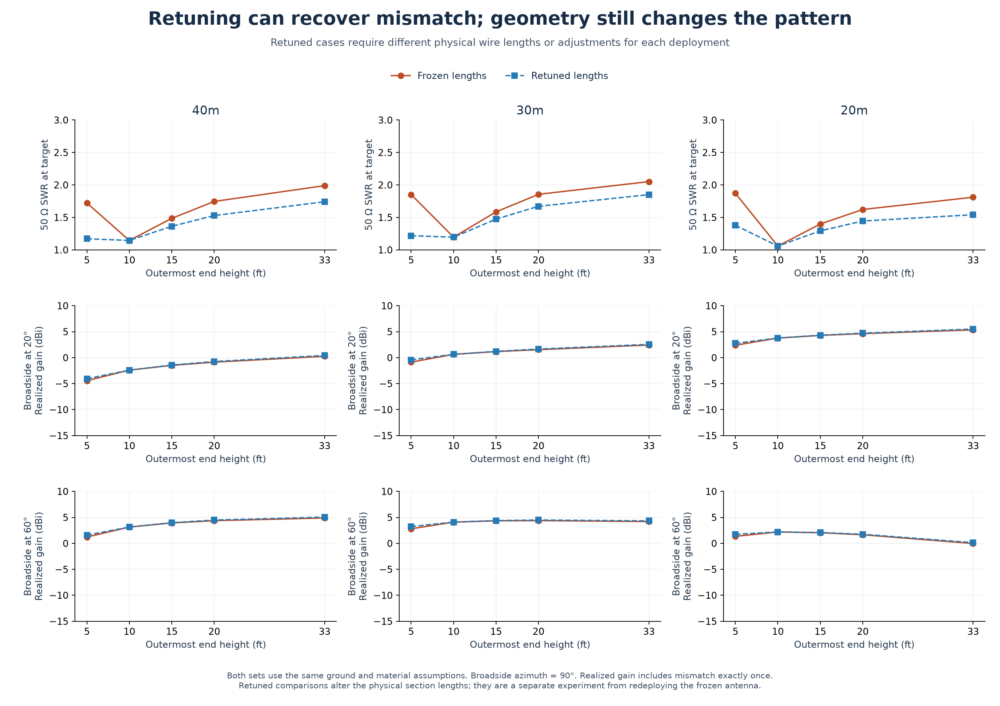](figures/retuning_comparison.png)

[Download PNG](figures/retuning_comparison.png) · [Download SVG](figures/retuning_comparison.svg)

This is an optional comparison, not a requirement to adjust the antenna for every deployment. Each row below retunes all three sections at that geometry and rechecks the complete assembly. Retuning cancels reactance at the target; it does **not** force the resistance to 50 Ω. An ideal lossless matching network would recover all of the reported mismatch loss, whereas length-only tuning usually recovers only part of it. No real tuner efficiency is assumed.

| Ends ft | 20m section ft | 30m extension ft | 40m extension ft | Target SWR 20/30/40 | η↑ % 20/30/40 |
| --- | --- | --- | --- | --- | --- |
| 5 | 16.845 | 6.632 | 9.691 | 1.38 / 1.22 / 1.17 | 54.1 / 50.6 / 34.5 |
| 10 | 16.661 | 6.524 | 9.635 | 1.06 / 1.20 / 1.15 | 60.8 / 59.3 / 45.7 |
| 15 | 16.561 | 6.468 | 9.582 | 1.29 / 1.47 / 1.36 | 64.1 / 64.2 / 53.4 |
| 20 | 16.503 | 6.443 | 9.538 | 1.44 / 1.67 / 1.53 | 65.9 / 67.4 / 58.9 |
| 33 | 16.443 | 6.470 | 9.501 | 1.54 / 1.85 / 1.74 | 67.2 / 70.9 / 66.8 |

The higher-end patterns and upward-efficiency advantage remain after retuning. For 5 ft→flat, the retuned realized 20° broadside improvements are 2.74 dB on 20m, 2.99 dB on 30m, 4.48 dB on 40m. Full retuned impedances, scans and patterns are in the data/viewer.

## Which conclusions survive uncertainty?

The soil/wire grid holds the nominal lengths fixed and combines all three grounds (poor εr=5, σ=0.001; average 13/0.005; good 20/0.03 S/m) with three homogeneous effective-conductivity proxies (1.4, 10 and 58 MS/m). The last is an optimistic smooth-copper comparison, not a claim that the CCS wire is copper. These bounded scenarios are exploratory, not measured limits or probabilities.

| Band | 5 ft→flat 20° realized dB | 5 ft→flat 60° realized dB | 5 ft η↑ % range | Flat η↑ % range |
| --- | --- | --- | --- | --- |
| 20m | 2.74 to 3.21 | -1.67 to -0.69 | 32.57 to 69.52 | 50.23 to 80.43 |
| 30m | 3.10 to 3.48 | 1.16 to 1.70 | 28.54 to 69.28 | 51.65 to 85.07 |
| 40m | 4.17 to 5.09 | 3.16 to 4.11 | 18.10 to 55.62 | 45.81 to 83.76 |

The lower-angle benefit survives this soil/wire grid on every band. The 20m high-angle tradeoff and the 40m high-angle improvement also survive. Absolute efficiency varies substantially; measure RF loss and soil before treating these percentages as properties of the actual antenna.

[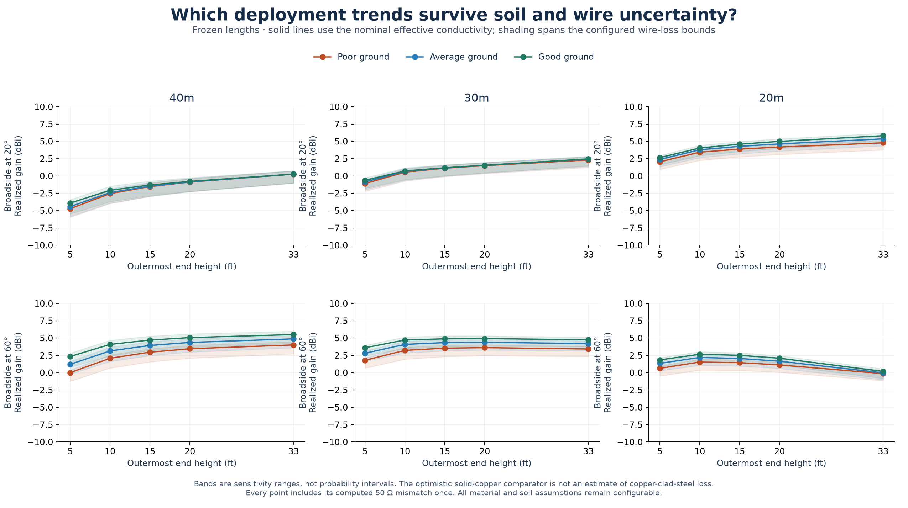](figures/soil_wire_sensitivity.png)

[Download PNG](figures/soil_wire_sensitivity.png) · [Download SVG](figures/soil_wire_sensitivity.svg)

Additional one-at-a-time tests keep all nominal lengths fixed. The following are maximum absolute changes over the three bands and five deployments (20m only for closing B), measured against the matching nominal case. They are sensitivity to these idealized dimensions, not a model of the unmeasured relaxed connector tails or folded wire.

| Sensitivity | ΔSWR | ΔX Ω | Δrealized 20° dB | Δη↑ percentage points |
| --- | --- | --- | --- | --- |
| Open gaps 10 / 100 mm | 0.48 | 11.6 | 0.34 | 0.11 |
| Contacts 0 / 0.2 / 0.5 Ω each | 0.02 | 0.1 | 0.08 | 0.57 |
| Sheath correction 0 / 1.5× | 2.63 | 45.1 | 1.83 | 0.12 |
| Close outer B links on 20m; A stays open | 0.14 | 2.1 | 0.06 | 0.16 |

The disconnected extensions participate through coupling even though they are not directly fed. Closing B on 20m joins the two disconnected outer sections per side into longer parasitic conductors; the comparison above tests that explicitly. Do not assume equivalence for closely folded tails, different gaps or different extension lengths.

For these collinear modeled tails, the B-open/B-closed differences in 20m gain are small enough to be practically negligible. The small impedance change is worth checking with an analyzer, but it does not change the deployment recommendation.

## Numerical verification and limits

**99/99 numerical checks pass.** The retained JSON/CSV contains individual results and tolerances.

- Three meshes (maximum long-wire segment 0.18/0.12/0.08 m), all 15 frozen cases: largest primary→fine ΔZ 0.106 Ω and peak-gain change 0.010 dB.
- Lossless full-sphere free-space average gain: worst bare error 0.013 dB; with reactive insulation retained 0.013 dB. No automatic average-gain correction is applied to reported gain.
- 2°→1° angular refinement: largest η↑ change 0.016 percentage points. An independent integration of printed Eθ/Eφ reproduces the gain normalization.
- 6/10/14 cm source-bridge check on steep/flat, every band: worst impedance spread 2.063 Ω, peak spread 0.020 dB. Total conductor path is held constant; the nearby bend and end positions move slightly.
- NEC's printed endpoint connectivity is checked, including the smallest open gap. Lossless isotropic/quadrature tests, free-space and perfect-ground sentinels, source-power and field/gain tests guard the 4π normalization and mismatch accounting.

η↑ = ∫upper 10^(GdBi/10) dΩ / **4π**. NEC printed efficiency alone is not η↑. The inferred residual closes the accepted-power ledger but does not independently separate local soil heating from surface-wave effects and numerical error. The source and thin-wire approximations set an accuracy floor; hundredths of a dB are computation detail, not field precision.

Actual coax length/type, choke, tuner and common-mode currents are unspecified and absent; the feedpoint is ideally balanced. Mast coupling, people, terrain, vegetation, sag, hardware dielectrics, actual strand/plating structure, dielectric loss, and folded/relaxed connector-tail routing are absent. The historical 1.09 SWR at 14.135 MHz and 1.42 at 14.315 MHz was taken with a different estimated 40 ft center and an uncertain measurement plane; it was **not used for calibration** and establishes no radiation-efficiency claim.

## Reproduce and validate in the field

```bash
uv sync --no-editable --extra plots --group dev
NEC2C_PATH=build/tools/nec2c mise run linked-dipole
mise run check
mise run linked-dipole-viewer
```

Use any installed nec2c via `NEC2C_PATH=/path/to/nec2c`; the exact executable hash is recorded. `config.json`, tuning history, `study.json`, CSVs, NEC decks/outputs, source/solver hashes and `SHA256SUMS` make the run inspectable. The repository's `verify-results` verifies full and compact manifests. Replace unknown dimensions in `configs/linked-dipole-v1.json` before interpreting modeled lengths as your antenna.

1. Measure final straight section lengths, folds/tails, closed bridge lengths and actual open separations; photograph the link routing. Record center, both links, tips, span and soil moisture for every deployment.
2. With unchanged wires, measure calibrated **feedpoint** R+jX sweeps at 5/10/15/20 ft ends, then flat if feasible. If measuring through coax, record and de-embed it. This directly tests the predicted downward resonance shift and usable match window.
3. On 20m repeat B open versus B closed with A open. Repeat with measured tail separations. Use a four-wire low-resistance measurement for contacts; obtain wire RF resistance from a suitable fixture or a measured length, not DC resistance alone.
4. For comparative radiation, use stable receive stations in several directions and alternate configurations quickly with controlled accepted power. Log many paired observations; one ionospheric path or SWR reading cannot measure efficiency. Check feedline common-mode current and choke dependence before attributing differences to the wire geometry.

## Saved artifacts

This README and its figures are the maintained GitHub-readable study. The offline viewer embeds the computed data and runs without a server. Raw NEC solves, expanded sweeps and complete generated runs stay under `build/`; their input identities and full-run manifest are retained.

| Artifact | Contents |
| --- | --- |
| [Offline viewer](viewer.html) | Download and open locally; band and deployment selection, patterns, SWR, and SVG export |
| [Summary CSV](summary.csv) | All frozen and retuned target-frequency metrics, resonance and bandwidth |
| [Geometry CSV](geometry.csv) | Span, apex, link heights, stakes and cords |
| [Sensitivity CSV](sensitivity.csv) | Soil, wire, links, contacts and insulation scenarios |
| [Numerical validation](numerical_validation.json) | Individual pass/fail results and convergence metrics |
| [Configuration](config.json) · [Tuning history](tuning.json) | Replaceable assumptions and nominal/retuned section dimensions |
| [Run metadata](run_metadata.json) · [Full-run reference](full_run.json) | Source, solver and full-run identity |
| [SHA256 manifest](SHA256SUMS) | Integrity checks for this result package |

### Sources and detailed method

- [Construction observation](https://rwjblue.com/notes/2026-09-13-compact-20-meter-dipole/)
- [Link insulators](https://www.printables.com/model/1842032-linked-dipole-link-insulators) (dimensions/tail uncertainty supplied by the operator)
- [DXE-SANTW-500](https://www.dxengineering.com/parts/dxe-santw-500) and [manufacturer wire specifications](https://www.dxengineering.com/search/part-type/wire?GroupBy=ProductName&SortBy=BestKeywordMatch&SortOrder=Ascending&keyword=insulators)
- [Cebik insulation approximation](https://hamwaves.com/wire/doc/Insulated%20Wires:%20The%20NEC-2%20Way.html)
- [NEC-2 user guide](https://www.nec2.org/other/nec2prt3.pdf); [power/gain audit](../../docs/linked-dipole-power-audit.md); [construction method and measurement plan](../../docs/case-studies/linked-dipole-method.md)
- [ARRL antenna modeling background and tutorials](https://www.arrl.org/antenna-modeling-for-beginners)
