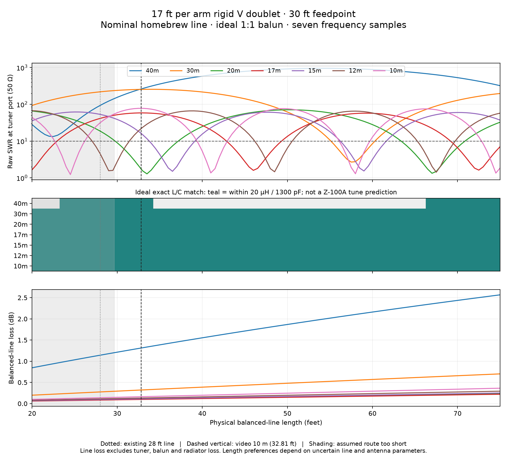

# Rigid V doublet — initial modeling

Two nominal 17 ft arms, with a reference feed
height of 30 ft and arms 30° above horizontal. The transcript at 12:36
says **10 meters / 32.81 ft of line**, not 20 meters. Exact whip extension,
angle, taper and line parameters remain unmeasured.

## Reference radiator

NEC reported efficiency is retained as solver bookkeeping, not a verified
total radiator/ground efficiency. Gains include the modeled real-ground
pattern at the antenna feedpoint, excluding line, balun and tuner losses.

| Band | Feedpoint R + jX (Ω) | NEC efficiency | Gain at 20° broadside (dBi) |
|---|---:|---:|---:|
| 40m | 12.3 -838.0j | 86.1% | 0.52 |
| 30m | 28.8 -408.1j | 92.0% | 2.84 |
| 20m | 62.7 +8.4j | 94.2% | 5.73 |
| 17m | 152.1 +460.3j | 95.5% | 7.34 |
| 15m | 458.6 +1019.7j | 96.7% | 7.32 |
| 12m | 2444.7 +1532.0j | 97.4% | 6.86 |
| 10m | 1872.3 -1982.7j | 97.3% | 6.28 |

## Video-length line, nominal homebrew parameters, ideal 1:1 interface

| Band | Tuner load R + jX (Ω) | SWR vs 50 Ω | Line loss (dB) | Ideal L (µH) | Ideal C (pF) | Continuous L/C screen |
|---|---:|---:|---:|---:|---:|---|
| 40m | 5.3 +258.8j | 261.5 | 1.31 | 17.64 | 114 | within limits |
| 30m | 1950.4 +4585.3j | 254.6 | 0.32 | 12.52 | 23 | within limits |
| 20m | 64.4 -28.8j | 1.8 | 0.11 | 0.41 | 42 | within limits |
| 17m | 2907.2 +192.0j | 58.4 | 0.10 | 3.33 | 23 | within limits |
| 15m | 97.4 -259.5j | 16.2 | 0.11 | 1.44 | 11 | within limits |
| 12m | 98.8 +309.5j | 21.8 | 0.13 | 1.44 | 46 | within limits |
| 10m | 3890.2 -120.2j | 77.9 | 0.16 | 2.45 | 13 | within limits |

## Length candidates for measurement

Ranked by dry continuous-L/C screen counts, then all-case counts, then
worst dry line loss. These are sensitivity counts, not tuner success rates.
A 4:1 entry uses ideal impedance division by four with zero balun loss.
The routing screen reserves 6 ft horizontal
offset and 2 ft slack to a 3 ft high tuner: 29.66 ft minimum.

| Line (ft) | Line (m) | Ideal ratio | Dry L/C screens | All L/C screens | Worst dry line loss (dB) |
|---:|---:|---:|---:|---:|---:|
| 30.00 | 9.14 | 1:1 | 21/21 | 28/28 | 1.74 |
| 30.00 | 9.14 | 4:1 | 21/21 | 28/28 | 1.74 |
| 30.50 | 9.30 | 1:1 | 21/21 | 28/28 | 1.77 |
| 30.50 | 9.30 | 4:1 | 21/21 | 28/28 | 1.77 |
| 31.00 | 9.45 | 1:1 | 21/21 | 28/28 | 1.79 |
| 31.00 | 9.45 | 4:1 | 21/21 | 28/28 | 1.79 |
| 31.50 | 9.60 | 1:1 | 21/21 | 28/28 | 1.82 |
| 31.50 | 9.60 | 4:1 | 21/21 | 28/28 | 1.82 |
| 32.00 | 9.75 | 1:1 | 21/21 | 28/28 | 1.84 |
| 32.00 | 9.75 | 4:1 | 21/21 | 28/28 | 1.84 |
| 32.50 | 9.91 | 1:1 | 21/21 | 28/28 | 1.86 |
| 32.50 | 9.91 | 4:1 | 21/21 | 28/28 | 1.86 |

## Numerical checks

A three-segment source bridge keeps the voltage source's adjacent
segments collinear. A single source segment between bent arms gave
poor average-gain/mesh convergence and was replaced before this run.
Lossless full-sphere average gain should be 1.0. This checks numerical
power balance, not agreement with the physical antenna.

| Band | Finest mesh AG | AG error (dB) | Impedance change vs preceding mesh | 20° gain change (dB) |
|---|---:|---:|---:|---:|
| 40m | 1.0010 | +0.004 | 0.10% | +0.01 |
| 30m | 1.0010 | +0.004 | 0.10% | +0.01 |
| 20m | 1.0010 | +0.004 | 0.11% | +0.00 |
| 17m | 1.0010 | +0.004 | 0.08% | +0.01 |
| 15m | 1.0010 | +0.005 | 0.09% | +0.00 |
| 12m | 1.0011 | +0.005 | 0.09% | +0.00 |
| 10m | 1.0012 | +0.005 | 0.09% | +0.00 |

## Interpretation boundaries

- Exact, continuous lossless low-pass L matching is checked against 20 µH
  and 1300 pF. This is not the LDG discrete bank or its search algorithm.
  Passing cannot guarantee a tune; failure cannot exclude a usable
  partial match.
- The separate 10:1 raw-SWR flag is the published range screen. A continuous
  solution outside 10:1 does not extend LDG's advertised specification.
- No tuner, balun, coax jumper, common-mode or truck loss is calculated.
- Mast variants only probe radiator-to-floating-mast interaction; the
  balanced-line model has no spatial route or mast/truck coupling.
- The 91/181/259 segment cases test numerical sensitivity at the reference
  geometry. They do not validate a tapered telescoping whip or its joints.
- Seven frequency samples do not establish full-band tuning coverage.

See [design notes](../../docs/case-studies/rigid-v-hitch-doublet.md) for
transcript provenance, winter mounting ideas and the measurement plan.

## Sources

- video: https://www.youtube.com/watch?v=0ZBsUXsak9Y
- z100a_manual: https://irp.cdn-website.com/4d6cc687/files/uploaded/Z-100A_Manual_Rev_B_10.pdf
- existing_line: configs/58ft-doublet-v1.0.json
- carbon_proxy: configs/53ft-efrw-elevated-v1.json

