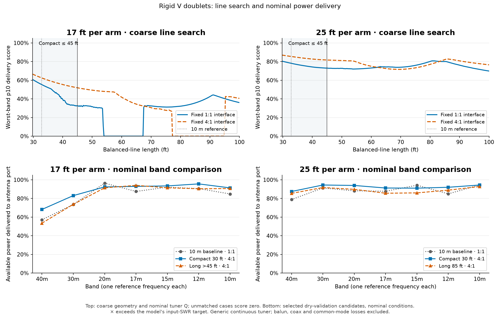
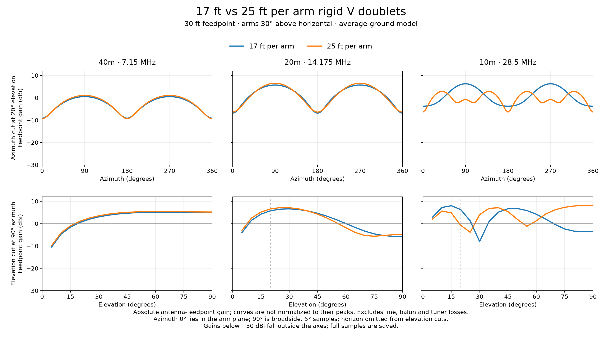

# Rigid V doublet: 17 ft vs 25 ft arms

These are the **best validated line lengths in the sampled search** for
compact (≤45 ft) and longer runs. Each choice keeps one line
length and one ideal transformer ratio across all seven bands.

| Arm length | Line region | Approx. line ft / m | Fixed ratio | All-frequency match scenarios | Worst-band p10 delivery | Limiting band |
|---:|---|---:|---:|---:|---:|---|
| 17 ft | compact | 30 / 9.1 | 4:1 | 100.0% | 54.6% | 40m |
| 17 ft | long | >45 / 13.8 | 4:1 | 100.0% | 37.9% | 40m |
| 25 ft | compact | 30 / 9.1 | 4:1 | 100.0% | 78.4% | 40m |
| 25 ft | long | 85 / 25.8 | 4:1 | 100.0% | 75.1% | 40m |

The compact candidates sit at the **shortest route-feasible grid
point**. Their advantage depends on the assumed routing constraint;
the installation still needs adequate supported line and slack.

Neither longer-run candidate improves on its compact counterpart
under the stated ranking objective.

Lengths are rounded starting points for a prototype, not precise cut
recommendations. Scores use the exact sampled lengths in the linked
CSV/JSON files; rounding a cut has not itself been validated.

The selected ratios are **ideal, lossless interfaces**. Their advantage
does not establish which real balun to use; incremental balun loss or
different common-mode behavior can reverse the modeled ordering.

The objective is transmitter-available power delivered to the **antenna
feedpoint**, including generic tuner dissipation, residual input mismatch
and balanced-line loss. It is not radiated power or total antenna
efficiency. Balun, coax, common-mode and truck losses are excluded.

Ranking first maximizes the fraction of dry scenarios that meet the
input-SWR target of 2.5:1 at **every one of 65 sampled
frequencies**, then maximizes the lowest band’s tenth-percentile delivery
score, then the geometric mean of the seven band medians. Unmatched
samples score zero. These equally weighted scenario fractions and
percentiles describe this grid; **they are not tuning probabilities**.

[](optimization_comparison.png)

[Download PNG](optimization_comparison.png) · [Download SVG](optimization_comparison.svg)

## Practical 30 ft line: both fixed ratios

At nominal 40 m conditions, this comparison holds physical line length
at exactly 30 ft. The final column is also the **extra 4:1 balun loss**
that would erase its modeled delivery advantage over the 1:1 interface
if other behavior stayed equal. Neither balun’s actual loss is modeled.

| Arms | 10 m / 1:1 baseline | 30 ft / 1:1 | 30 ft / ideal 4:1 | 4:1 advantage / loss margin |
|---:|---:|---:|---:|---:|
| 17 ft | 57.2% | 62.1% | 67.9% | +0.38 dB |
| 25 ft | 78.8% | 80.8% | 87.3% | +0.34 dB |

## Compared with the video’s 10 m line

Nominal conditions use the reference geometry, line parameters and tuner
Q profile, at one reference frequency per band. Percentages are delivered
antenna-port power divided by available transmitter power. Δ is the
delivery change in dB from the **same radiator’s 10 m / 1:1 baseline**.
An asterisk marks a sample outside the model’s input-SWR target; these
tables show its actual modeled delivery, while ranking scores it zero.

### 17 ft per arm

Compact: about 30 ft, 4:1. Long: >45 ft, 4:1.

| Band / MHz | 10 m baseline | Compact | Δ dB | Long | Δ dB |
|---|---:|---:|---:|---:|---:|
| 40m / 7.15 | 57.2% | 68.2% | +0.77 | 53.5% | -0.29 |
| 30m / 10.125 | 73.5% | 83.1% | +0.53 | 73.7% | +0.01 |
| 20m / 14.175 | 96.4% | 92.4% | -0.19 | 91.4% | -0.23 |
| 17m / 18.1 | 87.5% | 92.9% | +0.26 | 94.0% | +0.31 |
| 15m / 21.225 | 92.1% | 93.4% | +0.06 | 91.4% | -0.03 |
| 12m / 24.94 | 90.6% | 95.6% | +0.24 | 90.4% | -0.01 |
| 10m / 28.5 | 84.8% | 91.3% | +0.32 | 90.6% | +0.29 |

### 25 ft per arm

Compact: about 30 ft, 4:1. Long: 85 ft, 4:1.

| Band / MHz | 10 m baseline | Compact | Δ dB | Long | Δ dB |
|---|---:|---:|---:|---:|---:|
| 40m / 7.15 | 78.8% | 87.5% | +0.45 | 85.5% | +0.35 |
| 30m / 10.125 | 91.2% | 94.4% | +0.15 | 91.7% | +0.02 |
| 20m / 14.175 | 88.2% | 93.9% | +0.27 | 89.8% | +0.08 |
| 17m / 18.1 | 87.7% | 91.2% | +0.17 | 85.6% | -0.11 |
| 15m / 21.225 | 94.2% | 91.0% | -0.15 | 86.0% | -0.40 |
| 12m / 24.94 | 84.9% | 92.0% | +0.35 | 88.9% | +0.20 |
| 10m / 28.5 | 94.5% | 94.4% | -0.00 | 92.8% | -0.08 |

## Broad regions in the coarse search

For each selected fixed ratio, these sampled intervals stay within
0.2 dB of that arm/region/ratio’s best coarse p10 score, with no lower
all-frequency match fraction. They use the **reference geometry and
nominal tuner Q**, not the expanded dry validation ensemble. Interval
endpoints are grid coordinates, not physically established tolerances.
Only the shortlisted lengths receive expanded validation.

| Arms / region | Fixed ratio | Coarse near-best sampled intervals |
|---|---:|---|
| 17 ft / compact | 4:1 | 29.75–31.75 ft |
| 17 ft / long | 4:1 | 45.25–49.75 ft |
| 25 ft / compact | 4:1 | 29.75–38.75 ft |
| 25 ft / long | 4:1 | 45.25–55.25 ft; 82.25–93.25 ft |

## Dry robustness and separate wet stress

The 40 m column below is the dry validation tenth-percentile score
for 40 m, useful for assessing the short-radiator tradeoff. Wet results
use a deliberately adverse hypothetical line and do not influence
selection; they are not a prediction of actual rain, snow or icing.

| Arms / region | Dry 40 m p10 | Wet worst-band p10 | Wet all-frequency match scenarios |
|---|---:|---:|---:|
| 17 ft / compact | 54.6% | 34.2% | 100.0% |
| 17 ft / long | 37.9% | 23.4% | 100.0% |
| 25 ft / compact | 78.4% | 69.8% | 100.0% |
| 25 ft / long | 75.1% | 54.6% | 100.0% |

## How to interpret the comparison

- The coarse search evaluates 568 fixed line/ratio combinations per arm length at the reference geometry.
  The selected shortlist contains 113 combinations across both arm lengths, tested at 65 frequencies and 9 geometry/material/ground cases.
  It may miss a length that is weak at the reference geometry but
  stronger under other conditions. No global or exact cut-length optimum
  is established; sampled frequencies do not guarantee band coverage.
- Geometry perturbations are one at a time; this is not a complete
  joint uncertainty grid. Dry line loss, VF and geometry impedance
  assumptions are crossed with the component-Q profiles.
- The generic continuous tuner uses component maxima, assumed Q and
  contact resistance. Actual LDG banks, minimum steps, firmware,
  parasitics and voltage/current limits remain unknown. A modeled match
  does not establish a Z-100A match or a usable power rating.
- NEC gain includes modeled radiator effects. Subtracting delivery loss
  gives modeled directional gain relative to available transmitter power;
  multiplying by NEC efficiency again would count losses twice.
  Longer arms can change lobes and nulls; feedpoint delivery alone does
  not establish stronger radiation in a particular direction.
- The same hub height is used for both radiators. Longer arms also put
  their tips higher and widen the structure. Extended runs need a
  repeatable suspended route clear of the mast and vehicle; mast loading
  and actual feedline coupling are not validated by this calculation.

All fixed-ratio winners: [winners.json](winners.json). Full candidate ranking: [validated_rankings.csv](validated_rankings.csv).
Band detail: [validated_by_band.csv](validated_by_band.csv). Nominal loss and gain: [nominal_by_band.csv](nominal_by_band.csv).
Assumptions and provenance: [config.json](config.json), [summary.json](summary.json).

## Radiation pattern comparison

[](pattern_comparison.png)

[Download PNG](pattern_comparison.png) · [Download SVG](pattern_comparison.svg)

Numerical solver checks: [17ft csv](numerical/17ft/numerical_validation.csv), [17ft json](numerical/17ft/numerical_validation.json), [25ft csv](numerical/25ft/numerical_validation.csv), [25ft json](numerical/25ft/numerical_validation.json).

## Saved artifacts

- [Coarse rankings](coarse_rankings.csv) · [Validated rankings](validated_rankings.csv) · [Winners](winners.json)
- [Validated band detail](validated_by_band.csv) · [Nominal power and matching](nominal_by_band.csv) · [Wet stress](wet_stress.csv)
- [Absolute pattern samples](pattern_samples.csv) · [Pattern cases](pattern_cases.csv) · [NEC loads and input hashes](nec_loads.csv)
- [Configuration](config.json) · [Numerical-run summary](summary.json) · [Presentation provenance](presentation_metadata.json)
- [Package integrity manifest](SHA256SUMS)

The original numerical-run hashes remain in `summary.json`. Presentation
metadata identifies the saved inputs and source used to render this README
and its charts. Full scenario arrays and reusable solver caches remain
under `build/`; this maintained package retains the useful compact results.

## Reproduce

```bash
NEC2C_PATH=/path/to/nec2c mise run rigid-doublet-optimize
uv run antenna-lab verify-results build/rigid-v-line-optimization-v2
```

See the [design and measurement notes](../../docs/case-studies/rigid-v-line-optimization.md) for the compact
generation command, original video, assumptions and practical interpretation.

